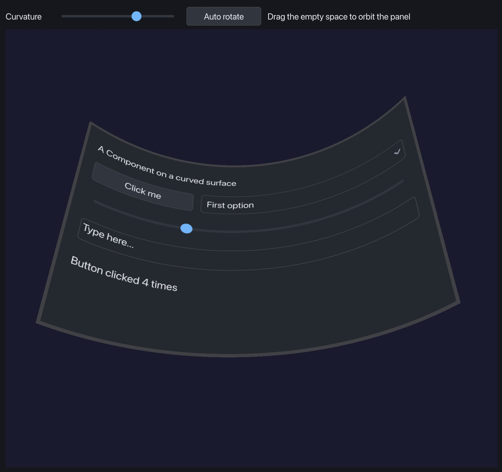

# Components in a scene

Any component can be shown on a mesh of a scene and stay fully interactive:
clicks, drags, hover, keyboard focus and popups keep working. The component
stays a child of the `SceneComponent` that draws the scene, which renders it to
a texture, puts the texture in a material, and maps input from its own points
onto the mesh.

<p align="center">
  
</p>

There are two ways to do it. The scene components do all of it for a scene
described with them, in a `.yui` document or in C++. A host written by hand
does each step itself, for a scene made of entities.

## With the scene components

The elements of a `.yui` [`Scene3D`](../ui/yui/scenes.md) are components, and
the tree they make is the tree of entities of the scene:

| Component | `.yui` element | What it is |
| --- | --- | --- |
| `SceneComponent` | `Scene3D` | The component showing the scene. |
| `SceneNodeComponent` | `Node3D` | An entity: a group, or a part of a model it is bound to by name. |
| `SceneCameraComponent` | `Camera3D` | A camera. |
| `SceneLightComponent` | `Light3D` | A light. |
| `SceneMeshComponent` | `Mesh3D` | A mesh made of the numbers it is given. |
| `SceneModelComponent` | `Model3D` | An instance of a glTF model, with its clips. |
| `SceneMaterialComponent` | `Material3D` | The material of the meshes around it. |

A component that is none of these, added to a node, is shown on the mesh of
that node. The node renders it to a texture, puts the texture in its material
and maps the pointer onto it:

```yui
Model3D {
    source: "models/computer.glb";

    Node3D {
        node: "Screen";

        Column { width: 416; height: 260;
            Label  { text: "Cutoff"; flexGrow: 1; }
            Slider { id: cutoff; preferredHeight: 28; }
        }
    }
}
```

The same from C++, where a node is added with `addAndMakeVisible()` as any
component is:

```cpp
auto model = std::make_unique<yup::SceneModelComponent>();
model->setSource (modelFile.getFullPathName());
view.addAndMakeVisible (*model);                    // view is a SceneComponent

auto screen = std::make_unique<yup::SceneNodeComponent>();
screen->setNodeName ("Screen");                     // the part of the model that shows the panel
model->addAndMakeVisible (*screen);

panel.setBounds (0.0f, 0.0f, 416.0f, 260.0f);
screen->addAndMakeVisible (panel);                  // shown on the screen, and used there
```

- The components of a node cover the texture coordinates 0 to 1 of the mesh
  that node draws, from the origin to their far corner.
- `setSurfaceSlot()`, the `surface` of a `Node3D`, chooses between
  `emissive`, for an interface that glows like a screen, and `baseColor`, for
  one lit as the rest of the object.
- A component added to the `SceneComponent` itself stays flat, over the scene.

The nodes take the pointer where they are shown, to the triangle, so they are
components for the mouse too: they have the hover and pressed states, a mouse
cursor and `onClick`. A node given a travel or a turn is a control that the
pointer drags in the scene, as the handle of a slider:

```cpp
auto fader = std::make_unique<yup::SceneNodeComponent>();
fader->setNodeName ("FaderA");

yup::Array<yup::var> travel;                        // how far the part slides over its range
travel.add (0.0);
travel.add (0.0);
travel.add (-0.78);
fader->setProperty ("travel", travel);

model->addAndMakeVisible (*fader);

fader->setValue (0.5);                              // halfway: getValue() follows the drags
```

```yui
Node3D { node: "FaderA"; travel: [0, 0, -0.78]; value <=> cutoff.value; }
Node3D { node: "KnobA"; rotation: [0, -45deg, 0]; turn: [0, -270deg, 0]; value <=> resonance.value; }
```

[3D scenes](../ui/yui/scenes.md) describes all of this: the
[surfaces](../ui/yui/scenes.md#components-on-3d-objects), the
[pointer](../ui/yui/scenes.md#interaction) and the
[draggable parts](../ui/yui/scenes.md#draggable-parts).

```{note}
The nodes take the mouse events of the meshes they show. A `SceneComponent`
subclass that moves its camera in `mouseDrag()` listens to them too, with
`addMouseListener (this, true)`. A scene made of entities alone, with no node
component, is not affected.
```

## By hand

The rest of this page covers the scene side of a host written by hand. The
input hooks and `MeshSurfaceMapper` are described in
[Components in 3D](../ui/component-3d.md); the Scene 3D demo
(`examples/graphics/source/examples/Scene3D.h`) uses this pattern for the LCD
of the MPC model.

### The material

Create the texture without a GPU texture, and use it in the material of the
mesh that shows the component. As emissive, the component keeps its colors
whatever the lighting; as base color, it is lit like the rest of the scene.

```cpp
screenTexture = new yup::Texture (yup::GpuTexture::Ptr(),
                                  yup::GpuSamplerDesc (yup::GpuFilter::linear, yup::GpuWrapMode::clampToEdge),
                                  true);

auto material = yup::Material::Ptr (new yup::Material());
material->baseColorFactor = { 0.0f, 0.0f, 0.0f, 1.0f };
material->emissiveTexture = screenTexture;
material->emissiveFactor = { 1.0f, 1.0f, 1.0f };

screen = scene->createEntity ("screen");
screen.attach<yup::MeshNode> (screenMesh);
screen.attach<yup::MaterialNode> (material);
```

The texture coordinates of the mesh decide where the component lands: `(0, 0)`
is its top left corner and `(1, 1)` its bottom right one. See
[Textures from the GPU](meshes-and-gltf.md#textures-from-the-gpu).

### Rendering the component

Mark the component as manually composited, so the host draws it instead of the
normal child painting, and hand its texture to the scene before drawing the
frame:

```cpp
ScreenView()
{
    panel.setManuallyComposited (true);
    addAndMakeVisible (panel);
}

void paint (yup::Graphics& g) override
{
    auto& context = g.getGraphicsContext();
    if (context.isGpuAvailable())
    {
        auto texture = panel.renderToTexture (context, 2.0f);
        if (panelRepainted)
            screenTexture->setGpuTexture (std::move (texture));

        panelRepainted = false;
    }

    yup::SceneComponent::paint (g);
    updateScreenMapping();
}
```

`renderToTexture()` only renders again when the panel repainted, but every
`setGpuTexture()` restarts the temporal accumulation of the full tier, so only
call it when the content changed: the demo sets a flag in the panel's
`paint()`. A scale above 1 keeps the panel sharp when the camera gets close.

### Mapping input

Give a `MeshSurfaceMapper` the same positions, texture coordinates and indices as
the mesh, and after each frame the matrix it was drawn with: the entity world
matrix followed by the camera view and projection.

```cpp
void updateScreenMapping()
{
    auto* camera = getScene()->getActiveCamera();
    if (camera == nullptr || getWidth() <= 0.0f || getHeight() <= 0.0f)
        return;

    const auto view = camera->getEntity().getWorldMatrix().inverted();
    const auto projection = camera->getProjectionMatrix (getWidth() / getHeight());

    const yup::SpinLock::ScopedLockType sl (mapperLock);
    mapper.setModelViewProjection (screen.getWorldMatrix().followedBy (view).followedBy (projection), getLocalBounds());
}
```

Then override `getChildPointFromLocal()` and `getLocalPointFromChild()` for the
panel, converting between viewport points and texture coordinates times the
panel size, as shown in [Routing input](../ui/component-3d.md#routing-input).
Return `std::nullopt` from `getChildPointFromLocal()` when the panel should not
take input, for example while the camera moves, and forward other children to
`SceneComponent`.

To let clicks outside the panel drive the camera, check
`mapper.hitTest (position)` in `mouseDown()`: unlike `viewportToUV()`, it does
not extrapolate beyond the mesh.
