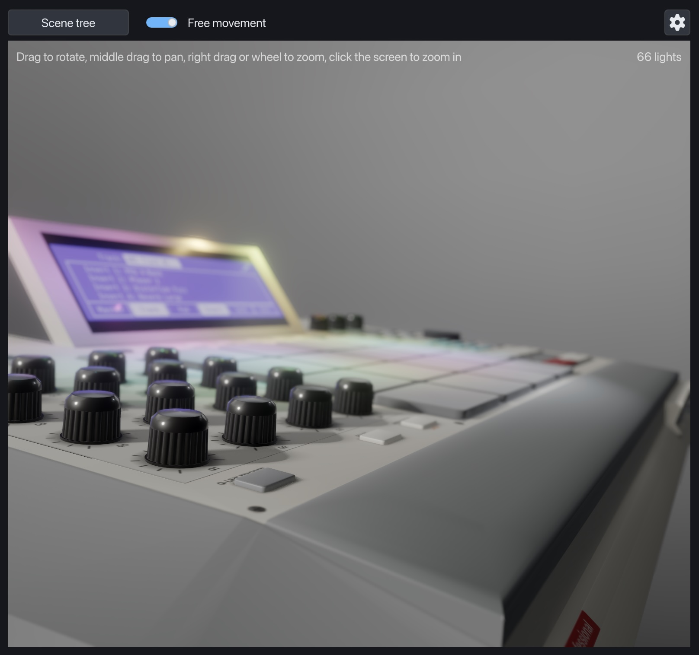

# 3D

Build 3D worlds out of entities, load glTF 2.0 assets into them, and show them
in a component, rendered through the [RHI](../graphics/rhi/index.md) on every
backend.

<p align="center">
  
</p>

**Modules covered:** `yup_3d` (with the `tinygltf` third-party module) and
`yup_renderer`.

`yup_3d` describes the world: entities, parts, resources, scenes, animation
and glTF loading. It has no renderer and depends only on `yup_rhi` and
`yup_graphics`. `yup_renderer` builds on it with `SceneRenderer`,
`SceneComponent`, `RenderSettings` and `RenderCapabilities`; link it to show
scenes on screen. Its shader permutations are compiled while the module builds,
see [module format](../build-system/module-format.md).

A scene can also be written with no code, as the elements of a
[`.yui` document](../ui/yui/scenes.md): `Scene3D`, `Camera3D`, `Light3D`,
`Mesh3D`, `Model3D` and `Material3D`, with bindings, style rules and
transitions on all of them.

## Concepts

- **`Scene`** - owns everything in a world: its entities, their nodes, the
  systems and the active camera. Scenes are reference counted (`Scene::Ptr`).
- **`Entity`** - a small value referring to an element of the scene tree. It
  has a name, a visibility flag that hides its whole subtree, child entities
  and attached **nodes**. Copying an entity copies the reference, not the
  element.
- **Nodes** (`Node` subclasses) - give an entity its data and behavior.
  `TransformNode` places it, `MeshNode` draws a mesh, `CameraNode` and
  `LightNode` place a camera and a light, and `MaterialNode` overrides the
  material of every mesh in the subtree. `AnimationNode` plays the clips of a
  model and `DeformNode` bends a mesh after its joints and its morph targets.
  An entity has at most one node of each type; an entity with no nodes is a
  plain group.
- **Systems** (`System` subclasses) - logic run once per `Scene::update()`
  across many nodes, in a declared order.
- **Resources** - `Mesh`, `Material`, `Texture`, `Skin` and `AnimationClip`
  are reference counted and shared: the same mesh can be drawn by any number of
  entities. Their CPU data is the source of truth; GPU buffers and textures are
  created the first time they are rendered, and follow a mesh that is given
  new vertices.
- **`SceneComponent`** (`yup_renderer`) - a `Component` that renders a scene and
  draws it over its whole area. Its `SceneRenderer`, from `getRenderer()`, holds
  the `RenderSettings`. It is the `Scene3D` of a `.yui` document.

Scenes, entities and nodes are meant to be used from the message thread, like
components.

## In this area

- [Entities and nodes](entities-and-nodes.md) - creating entities, attaching nodes,
  transforms, identifiers, views, collections, signals, custom nodes, systems
  and prefabs.
- [Meshes, textures and glTF](meshes-and-gltf.md) - building meshes and textures
  from code, changing them, and loading glTF assets into a scene.
- [Animation](animation.md) - playing the clips of a model, skins, morph
  targets and what they cost.
- [Showing a scene](showing-a-scene.md) - `SceneComponent`, scene features,
  rendering, scenes over 2D, and clearcoat and sheen materials.
- [Custom materials](custom-materials.md) - `MaterialShader`: a material
  written as a GLSL function.
- [Lights and shadows](lights-and-shadows.md) - light types, area lights and
  shadow maps.
- [Environment and indirect lighting](indirect-lighting.md) - environment maps,
  ambient occlusion, reflection probes, irradiance volumes and screen-space effects.
- [Post effects and fog](post-effects.md) - bloom, depth of field, motion blur
  and fog.
- [Render settings](render-settings.md) - `RenderSettings` and frame statistics.
- [Platform tiers](platform-tiers.md) - the raster and full tiers, temporal
  anti-aliasing and upscaling.
- [Components in a scene](components-in-a-scene.md) - interactive components
  drawn on meshes, such as screens and panels, and parts of a model dragged as
  controls.
- [3D scenes in `.yui`](../ui/yui/scenes.md) - a scene written as the elements
  of a document, with no code: cameras, lights, meshes, models, materials,
  clips and interaction.

```{toctree}
:hidden:
:maxdepth: 1

entities-and-nodes
meshes-and-gltf
animation
showing-a-scene
custom-materials
lights-and-shadows
indirect-lighting
post-effects
render-settings
platform-tiers
components-in-a-scene
```
