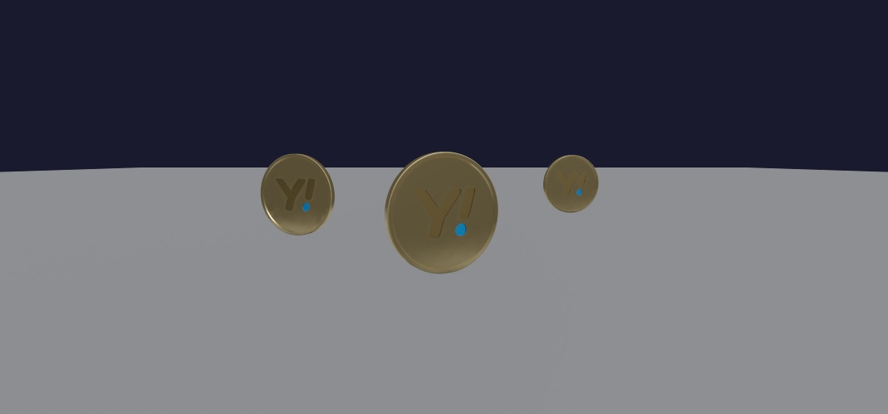

# Showing a scene

```cpp
class Viewer : public yup::Component
{
public:
    explicit Viewer (const yup::GltfModel& model)
    {
        auto scene = yup::Scene::Ptr (new yup::Scene());
        model.instantiate (*scene);

        auto camera = scene->createEntity ("camera");
        camera.attach<yup::CameraNode>();
        camera.attach<yup::TransformNode> (yup::Vector3<float> { 0.0f, 0.5f, 4.0f });
        scene->setActiveCamera (camera);

        view.setScene (scene);
        addAndMakeVisible (view);
    }

    void resized() override { view.setBounds (getLocalBounds()); }

private:
    yup::SceneComponent view;
};
```

<p align="center">
  
</p>

Cameras look down the -Z axis of their entity with +Y up, like glTF cameras.
When the active camera's entity is gone or has no `CameraNode`, the
first camera found in the visible tree is used; with no camera at all, a default
perspective camera at (0, 0, 5) looks at the origin. Without any `LightNode`, a
default directional light is used unless you turn it off with a
`DefaultLightNode`, see [Scene features](#scene-features).

`SceneComponent` draws only when it repaints: call `repaint()` after changing the
scene. For animated scenes, `setContinuousUpdates (true)` calls `Scene::update()`
and repaints on every display frame, which is what plays the
[clips](animation.md) of a model. On the full tier it also keeps repainting by
itself until the image has converged, see [Platform tiers](platform-tiers.md).

A scene that stands still asks nothing of its window, which is then free to skip
the frames it has nothing to paint in:

- The component takes every display frame while it updates continuously, while
  a clip of a `Model3D` plays, while a `Material3D` names a shader and while a
  node shows [components on its mesh](components-in-a-scene.md).
- Otherwise it takes the frames that follow a change of its components, and
  the one that follows each of its paints, until nothing is left to do. A
  change made to the `Scene` from code is found there, which is why it needs
  the `repaint()`.
- While it is not showing, itself or a component it is in being hidden, it
  takes no frame: the scene is not updated, clips included, and the renderer
  lets go of the textures it rendered into
  (`SceneRenderer::releaseTargets()`). Shown again, it carries on from where it
  was, and the full tier refines its image again.

In a `.yui` document the component is the `Scene3D` element, and the scene is
written inside it with no code: see [3D scenes](../ui/yui/scenes.md).

```yui
Scene3D {
    background: #101014; exposure: 1.2; toneMapping: agx;

    Camera3D { position: [0, 0.5, 4]; lookAt: [0, 0, 0]; }
    Light3D  { type: point; position: [2, 3, 2]; intensity: 20; }
    Model3D  { source: "models/coin.glb"; }
}
```

## Scene features

Scene-wide rendering features are nodes from `yup_renderer`, attached like any
other node. The renderer resolves them once per frame into a `SceneSettings`:
for each type, the node nearest to the root in the visible part of the tree wins,
the first attached among equals, so attach them to the root to be sure they apply. A missing node keeps its default.

| Node               | Fields                                   | Default                  |
| ------------------ | ---------------------------------------- | ------------------------ |
| `BackgroundNode`   | `color`                                  | dark blue (`0xff1a1a2e`) |
| `AmbientLightNode` | `color`                                  | gray (`0xff595959`)      |
| `ExposureNode`     | `exposure`                               | 1                        |
| `ToneMappingNode`  | `type` (`ToneMappingOperator`)           | `reinhard`               |
| `DefaultLightNode` | `enabled`                                | true                     |
| `EnvironmentNode`  | `map`, `intensity`, `visible`, `blur`    | no environment           |
| `WorldFogNode`     | `fog` (`WorldFog`)                       | no fog                   |

```cpp
auto root = scene->getRoot();
root.attach<yup::BackgroundNode> (yup::Colors::black);
root.attach<yup::ToneMappingNode> (yup::ToneMappingOperator::agx);

const auto settings = yup::SceneSettings::resolve (*scene); // what the renderer will use
```

`SceneComponent` has a setter for the first five, which attaches the node to
the root of its scene: `setBackgroundColor()`, `setAmbientColor()`,
`setExposure()`, `setToneMapping()` and `setDefaultLightEnabled()`. They are
the properties of a `Scene3D`.

**Upgrading.** The `Scene` setters and getters for these features are removed:
`setBackgroundColor`, `setAmbientColor`, `setExposure`, `setToneMapping`
(`Scene::ToneMapping` is now `ToneMappingOperator`), `setUsingDefaultLight`,
`setEnvironment`, `setEnvironmentIntensity`, `setEnvironmentVisible`,
`setEnvironmentBlur` and `setWorldFog`. Attach the matching node instead.
`EnvironmentMap`, `SphericalHarmonics`, `WorldFog`, `ReflectionProbeNode` and
`IrradianceVolumeNode` moved from `yup_3d` to `yup_renderer`.

## Scenes over 2D

A `BackgroundNode` color with an alpha below 1 lets what lies behind the
`SceneComponent` show wherever no surface covers it, so a scene is one layer
among the others of an interface:

```cpp
// No background at all: only the surfaces are drawn over what is behind
scene->getRoot().attach<yup::BackgroundNode> (yup::Colors::transparentBlack);

// Or a tinted pane: 20% of the color, 80% of what lies behind
scene->getRoot().attach<yup::BackgroundNode> (yup::Colors::black.withAlpha (0.2f));

view.setScene (scene);
```

[Scenes over 2D](../ui/yui/scenes.md#scenes-over-2d) shows one over a drawing,
written in a `.yui` document.

- The alpha of the background is how much of it is there. What is behind
  shows through the rest, through the antialiased edges of the surfaces by
  their coverage, and through blended materials by what their alpha lets
  through. Opaque and masked materials are opaque.
- The component follows the background: it is opaque while the background is,
  and not otherwise. It keeps `isOpaque()` up to date by itself, when the scene
  is set and at the display frames it takes, so do not call `setOpaque()` on
  it. A color written to the `BackgroundNode` of a scene that stood still is
  found by the frame after the paint that follows it: that paint still fills
  the component, and the scene is painted once more.
- A scene that is not opaque has its parent paint what is behind it each time
  the scene repaints, which an opaque one spares.
- A visible environment (`EnvironmentNode::visible`) covers everything, and
  the world fog covers what it fills.
- Bloom around a bright surface is added to what lies behind. Depth of field
  and motion blur behave as described in [Post effects](post-effects.md).
- `SceneRenderer::render()` returns a texture whose colors are multiplied by
  their alpha, as `Graphics::drawTexture()` takes it, whatever the background.

## Rendering

`SceneRenderer` renders a scene into a texture and can be used without a
component. Shading follows the glTF BRDF (GGX, Smith, Schlick) with punctual
and area lights, a flat ambient term, environment lighting, shadows, normal
mapping, alpha masking and blending, and double-sided materials; the result is
exposed, tone mapped and sRGB encoded. Skinned and morphed meshes are deformed
on the CPU before they are drawn, see [Animation](animation.md), and a mesh can
be colored by a function of your own instead of this shading, see
[Custom materials](custom-materials.md).

**Deferred and forward.** On the full tier, opaque and masked materials are
drawn once into a set of intermediate targets, then shaded in a single pass per
pixel, so overlapping objects and many lights cost little. Blended materials are
drawn after that with forward shading, over the shaded image. On the raster tier
every material is drawn with forward shading. Both paths shade with the same
model, so a material looks the same on either tier.

Image quality:

- **MSAA** antialiases geometry edges with 4 samples per pixel by default.
  Change it with `getRenderer().setSampleCount (n)`; the count is limited to what
  the device supports, and 1 turns multisampling off. It only affects the raster
  tier: the full tier antialiases with TAA instead.
- **Specular antialiasing** widens the highlights of very smooth surfaces where
  the normal changes quickly across a pixel, so they don't sparkle while moving.
- **Anisotropic filtering** keeps glTF textures sharp at grazing angles on
  devices that support it.

## Clearcoat and sheen

Two optional layers go over a material, after the glTF extensions of the same
names:

- **Clearcoat:** a clear varnish, as on car paint, lacquered wood or a glossy
  knob cap. `clearcoatFactor` sets its strength (0 for none) and
  `clearcoatRoughnessFactor` how blurred its reflections are. It reflects the
  lights, the reflection probes and the environment through its own sharp
  highlight, on top of the material's own reflections, and dims what lies under
  it, the emission included, a little head-on and more at grazing angles.
- **Sheen:** the soft glow of velvet, felt or rubber at grazing angles.
  `sheenColorFactor` sets its color (black for none) and `sheenRoughnessFactor`
  how wide the glow spreads. It reflects the lights and the diffuse light of the
  ambient color, the irradiance volumes and the environment, and dims the
  material under it.

```cpp
auto paint = yup::Material::Ptr (new yup::Material());
paint->baseColorFactor = { 0.6f, 0.05f, 0.05f, 1.0f };
paint->metallicFactor = 0.0f;
paint->clearcoatFactor = 1.0f;
paint->clearcoatRoughnessFactor = 0.05f;
```

Both factors default to 0, which shades a material exactly as without the
layers. A frame that draws any material with a layer shades with heavier shaders
on the raster tier, and for its opaque materials on the full tier; frames
without layered materials, reflection probes and irradiance volumes included,
never run them. Layered surfaces cost about as much again as plain ones.

The textures of both extensions (`clearcoatTexture`,
`clearcoatRoughnessTexture`, `clearcoatNormalTexture`, `sheenColorTexture` and
`sheenRoughnessTexture`) are ignored. Without a clearcoat normal texture the
varnish follows the surface without its normal map on the raster tier and for
the full tier's blended materials. On the full tier, opaque materials have only
their normal-mapped normal, so there the clearcoat highlights follow the normal
map too. Reflection probes and irradiance volumes capture the materials without
their layers.

Where the surface curves sharply within a pixel, as on the ribs of a small knob
seen from afar, the clearcoat's reflections are blurred as the material's own
are, so a smooth varnish doesn't break into thin, flickering lines.

Two approximations keep layered frames fast:

- The sheen dims the material under it by how much it reflects towards the
  viewer, the same for every light. The glTF extension also accounts for the
  angle of each light, which this skips: under a white sheen, a light at 60
  degrees from the surface normal lights the material up to about a quarter too
  brightly (20% of its brightness without the sheen). Darker sheens, and lights
  facing the surface, show less.
- Under an area light (a `LightNode` with a radius), the sheen is lit as if the
  light came from its center. It is exact for small lights and smooth for large
  ones, but a large, close light gives a slightly different sheen than a bank of
  small ones would.

On the full tier only the pixels of clearcoat and sheen materials pay for the
layers: a few small layered objects leave the rest of the frame at the cost of a
scene without them.
