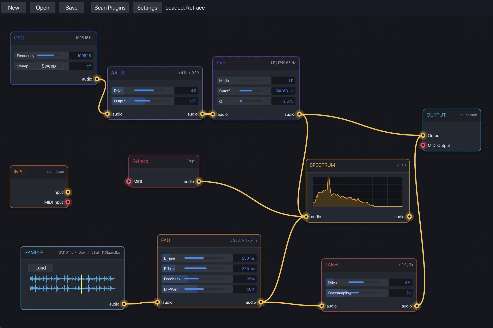

# Audio graph

The audio graph runs a set of processors connected by audio and MIDI wires as one
`AudioProcessor`. You edit the topology on the message thread, commit it, and the
audio thread picks up the new version at the next block without locking or
allocating. The graph compensates latency between paths, can process independent
branches on worker threads, and saves and restores itself together with the state
of every node.

**Module:** `yup_audio_graph`

<p align="center">
  
</p>

## Model and processor

A graph is split in two objects:

| Class | Role | Thread |
|---|---|---|
| `AudioGraphModel` | The editable description: nodes, connections and node metadata. It owns the node processors. | Message thread |
| `AudioGraphProcessor` | An `AudioProcessor` that compiles the model into an immutable processing plan and renders it. | Commit on the message thread, `processBlock` on the audio thread |

The model is shared through a `std::shared_ptr`, so the processor, the editor
component and your own code can all hold it:

```cpp
auto model = std::make_shared<yup::AudioGraphModel>();
auto graph = std::make_shared<yup::AudioGraphProcessor> (model);
```

Editing the model never touches the audio thread. When you call
`AudioGraphProcessor::commitChanges()`, the processor validates the model, prepares
any new node, builds a new plan with all its buffers preallocated, and publishes it.
The audio thread swaps to the new plan at the start of its next block, and the old
plan is released by a later commit, never on the audio thread. If the commit fails, the previous plan
keeps playing.

Because commits are explicit, you can batch many edits and pay for a single
recompile. `hasUncommittedChanges()` tells whether the model has topology edits
that are not published yet.

## Adding nodes

Any `AudioProcessor` can be a node: your own processors (`GainProcessor` below stands for one), hosted plugins (see
[Plugin hosting](plugin-hosting.md)) or another `AudioGraphProcessor`. The model
takes ownership and returns an `AudioGraphNodeID`, which stays stable until the
node is removed:

```cpp
yup::AudioGraphNodeProperties properties;
properties.identifier = "gain";
properties.name = "Gain";
properties.positionX = 200.0f;
properties.positionY = 120.0f;

const auto gainNode = model->addNode (std::make_unique<GainProcessor>(), properties);

if (! gainNode.isValid())
    return;
```

| Method | Description |
|---|---|
| `addNode (processor)` / `addNode (processor, properties)` | Adds a node and returns its ID. |
| `removeNode (id)` | Removes the node and every connection that mentions it. Returns `false` if the node does not exist. |
| `replaceNode (id, processor, properties)` | Swaps the processor while keeping the ID. Connections whose bus type or channel count no longer match are dropped. |
| `getNodeProcessor (id)` | Returns the processor of a node, or `nullptr`. |
| `getNodeIDs()` | Returns the IDs of all processor nodes. |
| `clear()` | Removes every node and connection. |

`AudioGraphNodeID::invalid()` is the null ID, and `getRawID()` returns the
underlying `uint64` if you need to store it.

## Endpoints and buses

Connections go between `AudioGraphEndpoint`s. An endpoint is a bus of a node or a
bus of the graph itself:

| Factory | Kind | Used as |
|---|---|---|
| `AudioGraphEndpoint::graphInput (bus)` | A graph input bus | Source |
| `AudioGraphEndpoint::nodeOutput (nodeID, bus)` | An output bus of a node | Source |
| `AudioGraphEndpoint::nodeInput (nodeID, bus)` | An input bus of a node | Destination |
| `AudioGraphEndpoint::graphOutput (bus)` | A graph output bus | Destination |

The bus index refers to the `AudioBusLayout` of the node processor, or of the graph
for the graph endpoints. Audio and MIDI buses are indexed together, in the order
of the layout. There is no separate sidechain concept: a sidechain is just another
input bus of the processor.

The default graph layout, `AudioGraphProcessor::createDefaultBusLayout()`, has:

| Bus index | Inputs | Outputs |
|---|---|---|
| 0 | `Input`, stereo audio | `Output`, stereo audio |
| 1 | `MIDI Input` | `MIDI Output` |

Pass another layout as the second constructor argument to change it:

```cpp
yup::AudioBusLayout layout ({ yup::AudioBus ("Input", yup::AudioBus::Type::Audio, yup::AudioBus::Direction::Input, 2) },
                            { yup::AudioBus ("Output", yup::AudioBus::Type::Audio, yup::AudioBus::Direction::Output, 2) });

auto graph = std::make_shared<yup::AudioGraphProcessor> (model, std::move (layout));
```

The model also keeps two boundary nodes for editors, with the fixed IDs
`AudioGraphModel::getGraphInputNodeID()` and `getGraphOutputNodeID()`. They carry
no processor, but you can store their canvas position with `setNodePosition()`.

## Connecting nodes

`addConnection()` takes an `AudioGraphConnection`, a plain pair of source and
destination endpoints:

```cpp
model->addConnection ({ yup::AudioGraphEndpoint::graphInput (0),
                        yup::AudioGraphEndpoint::nodeInput (gainNode, 0) });

model->addConnection ({ yup::AudioGraphEndpoint::nodeOutput (gainNode, 0),
                        yup::AudioGraphEndpoint::graphOutput (0) });

if (const auto result = graph->commitChanges(); result.failed())
    YUP_DBG (result.getErrorMessage());
```

A source can feed any number of destinations. When several connections reach the
same input, the graph sums them: audio is mixed and MIDI events are merged.
`removeConnection()` returns `false` when the connection does not exist, and
`getConnections()` returns a copy of the current list.

## Validation and committing

Validation happens in two steps.

`addConnection()` returns a failed `Result` straight away when:

- the source is not a source or the destination is not a destination;
- the connection already exists;
- a node does not exist or the bus index is out of range;
- an audio bus is connected to a MIDI bus;
- the two audio buses have different channel counts.

`commitChanges()` then checks the whole topology, including the graph boundary
buses and cycles (a loop fails with "Audio graph contains a cycle"), and prepares
the new nodes at the current sample rate and block size. A failed commit leaves the
audio thread on the previous plan, so undo the edit in the model to keep both in
sync:

```cpp
bool connect (const yup::AudioGraphConnection& connection)
{
    if (model->addConnection (connection).failed())
        return false;

    if (graph->commitChanges().wasOk())
        return true;

    model->removeConnection (connection);
    graph->commitChanges();
    return false;
}
```

For immediate UI feedback while the user drags a wire, call
`AudioGraphProcessor::validateConnection()`, which checks a connection against the
model and the graph bus layout without changing anything.

## Node properties

`AudioGraphNodeProperties` is the persistent metadata of a node:

| Field | Description |
|---|---|
| `identifier` | Stable key used by the node factory to recreate the node when loading. |
| `name` | Display name. |
| `positionX`, `positionY` | Canvas position, in units you choose. |
| `creationData` | Opaque `MemoryBlock` for anything else the factory needs, such as a serialized plugin description. |

Read and write them with `getNodeProperties()` (an `std::optional`),
`setNodeProperties()` and `setNodePosition()`. Metadata edits do not change the
topology and do not need a commit.

The graph has no bypass or mute property of its own. Bypass a hosted plugin with
`AudioPluginInstance::setBypassed()` (see [Plugin hosting](plugin-hosting.md)), or
handle it in your processor.

## Latency compensation

The graph reads `getLatencySamples()` of every node and inserts a delay line on
each connection that arrives earlier than the others, for both audio and MIDI, so
all paths reaching an input or the graph outputs stay aligned. The graph reports
the resulting latency through its own `getLatencySamples()`.

When a node changes its latency with `setLatencySamples()`, the graph recompiles
itself and notifies its listeners with `updateHostDisplay()`, so a host above it
learns the new value. The recompile runs on the thread that reported the change,
so change latency from the message thread, not from `processBlock()`.

## Tail

The graph reports a tail through `getTailSamples()`, like any processor. The tail
of a path is the sum of the tails of its nodes, and the graph tail is the longest
one reaching a graph output; nodes that reach no output do not count. It is
`infiniteTailSamples` as soon as one node on such a path never ends.

The value is computed by `commitChanges()` and cached, so reading it is safe on
the audio thread. When a node reports a tail change with
`updateHostDisplay (ChangeDetails().withTailChanged (true))`, the graph refreshes
the value without recompiling and notifies its own listeners when it changed.

To remove a node without cutting its sound, stop feeding it, keep processing for
its `getLatencySamples() + getTailSamples()` samples, then remove it and commit.
Fade out a node whose tail is infinite.

## Running the graph on a device

`AudioGraphProcessor` is a regular processor. To play it on an audio device,
prepare it when the device starts and feed it from the device callback. The
default bus layout processes in place, so copy the inputs into the output buffer
first:

```cpp
class GraphPlayer : public yup::AudioIODeviceCallback
{
public:
    void audioDeviceAboutToStart (yup::AudioIODevice* device) override
    {
        midiCollector.reset (device->getCurrentSampleRate());
        midiBuffer.ensureSize (4096);

        graph->prepareToPlay (yup::AudioSpec (static_cast<float> (device->getCurrentSampleRate()),
                                              device->getCurrentBufferSizeSamples()));
    }

    void audioDeviceIOCallbackWithContext (const float* const* inputChannelData,
                                           int numInputChannels,
                                           float* const* outputChannelData,
                                           int numOutputChannels,
                                           int numSamples,
                                           const yup::AudioIODeviceCallbackContext&) override
    {
        yup::AudioBuffer<float> buffer (outputChannelData, numOutputChannels, numSamples);
        buffer.clear();

        for (int ch = 0; ch < yup::jmin (numInputChannels, numOutputChannels); ++ch)
            if (inputChannelData[ch] != nullptr)
                yup::FloatVectorOperations::copy (outputChannelData[ch], inputChannelData[ch], numSamples);

        midiCollector.removeNextBlockOfMessages (midiBuffer, numSamples);

        yup::ParameterChangeBuffer noParameterChanges;
        yup::AudioProcessContext<float> context { buffer, midiBuffer, noParameterChanges };
        graph->processBlock (context);
    }

    void audioDeviceStopped() override
    {
        graph->releaseResources();
    }

    std::shared_ptr<yup::AudioGraphProcessor> graph;
    yup::MidiMessageCollector midiCollector;
    yup::MidiBuffer midiBuffer;
};
```

`prepareToPlay()` stores the sample rate and block size and commits the model.
Blocks larger than the prepared size are split, and a suspended graph outputs
silence. `flush()` resets every node and clears the delay lines.

Nodes receive the play head of the incoming context, but not its parameter
changes: change node parameters through their own `AudioParameter` objects. See
[Audio devices](devices.md) for opening the device and
[Processors](processors.md) for the process context.

## Parallel processing

By default the graph renders on the audio thread only. `setNumWorkerThreads()`
lets it run independent branches on worker threads (`0` disables them). The value
is a hint: the graph may use fewer threads depending on the topology. To keep the
workers in the same real-time scheduling group as the device thread, pass the
device workgroup with `setAudioWorkgroup()`:

```cpp
graph->setNumWorkerThreads (3);

if (auto* device = deviceManager.getCurrentAudioDevice())
    graph->setAudioWorkgroup (device->getWorkgroup());
```

Both calls belong on the message thread and take effect with the next committed
plan.

## Saving and restoring

`createXml()` writes the topology, the node properties and the state of every node:
nodes that support `DataTree` state (`supportsDataTreeState()`) are saved as a
tree, the others with `saveStateIntoMemory()`. `saveStateIntoMemory()` and
`loadStateFromMemory()` wrap the same XML, so a graph inside a plugin or another
graph saves like any processor.

To restore, the model must be able to recreate the processors. Give it a
`NodeFactory` that builds a processor from the saved `AudioGraphNodeProperties`:

```cpp
model->setNodeFactory ([] (const yup::AudioGraphNodeProperties& properties)
                           -> yup::ResultValue<std::unique_ptr<yup::AudioProcessor>>
{
    if (properties.identifier == "gain")
    {
        std::unique_ptr<yup::AudioProcessor> processor = std::make_unique<GainProcessor>();
        return yup::makeResultValueOk (std::move (processor));
    }

    return yup::makeResultValueFail ("Unknown node: " + properties.identifier);
});

if (const auto result = graph->loadStateFromMemory (savedState); result.failed())
    YUP_DBG (result.getErrorMessage());
```

Without a factory, restoring fails with "Audio graph node factory is not
configured". Every processor is created before anything is replaced, so a failed
restore leaves the model untouched. `AudioGraphProcessor::restoreFromXml()` and
`loadStateFromMemory()` also commit the restored model, and roll it back to the
previous version if the commit fails. Restore while the graph is not processing,
for example with the device stopped.

For undo, `AudioGraphModel::createSnapshot()` and `restoreSnapshot()` capture and
restore the whole model in memory. `getRevision()` changes on every edit and
`getTopologyRevision()` only on topology edits, which is handy to refresh a UI.

## Allocation stats

`getAllocationStats()` describes the last committed plan. Use it in diagnostics or
tests to see what the graph preallocated:

| Field | Meaning |
|---|---|
| `scratchAudioBuffers` | Node scratch audio buffers. |
| `midiBuffers` | Node MIDI buffers. |
| `delayLines` | Per-connection latency compensation delay lines. |
| `totalCompensationSamples` | Largest compensation inserted on a path to the graph outputs. |
| `maxPreallocatedChannels` | Largest channel count used by a node or graph endpoint. |
| `maxPreallocatedBlockSize` | Block size the plan was built for. |

## Editing in a UI

`AudioGraphComponent` in `yup_audio_gui` is a zoomable node editor for a model, with
undo support. It draws `AudioGraphNodeView`s you provide and asks your code to
apply each edit. See [Audio GUI](audio-gui.md#graph-editor).

## Hosting plugins in the graph

A loaded `AudioPluginInstance` is an `AudioProcessor`, so it goes into the graph with
`addNode()`. Store what you need to reload it, typically the
`AudioPluginDescription`, in `creationData`, and have the node factory load the
plugin again from it. See [Plugin hosting](plugin-hosting.md).

## Threading rules

| Call | Thread |
|---|---|
| All `AudioGraphModel` methods | Message thread (the model is internally locked, but it is meant to be edited from one control thread) |
| `commitChanges()`, `validateConnection()`, `setNumWorkerThreads()`, `setAudioWorkgroup()` | Message thread |
| `createXml()`, `restoreFromXml()`, `saveStateIntoMemory()`, `loadStateFromMemory()` | Message thread |
| `prepareToPlay()`, `releaseResources()` | Device start and stop callbacks |
| `processBlock()` | Audio thread, realtime-safe |

See [the audio thread](../core/multithreading/index.md#the-audio-thread) for the
general rules.

## Related pages

- [Processors](processors.md) - the `AudioProcessor` model that every node implements.
- [Plugin hosting](plugin-hosting.md) - loading third-party plugins as graph nodes.
- [Audio GUI](audio-gui.md) - the graph editor component and node views.
- [Audio devices](devices.md) - running a graph on an audio device.
- [Audio overview](index.md) - the audio area at a glance.
