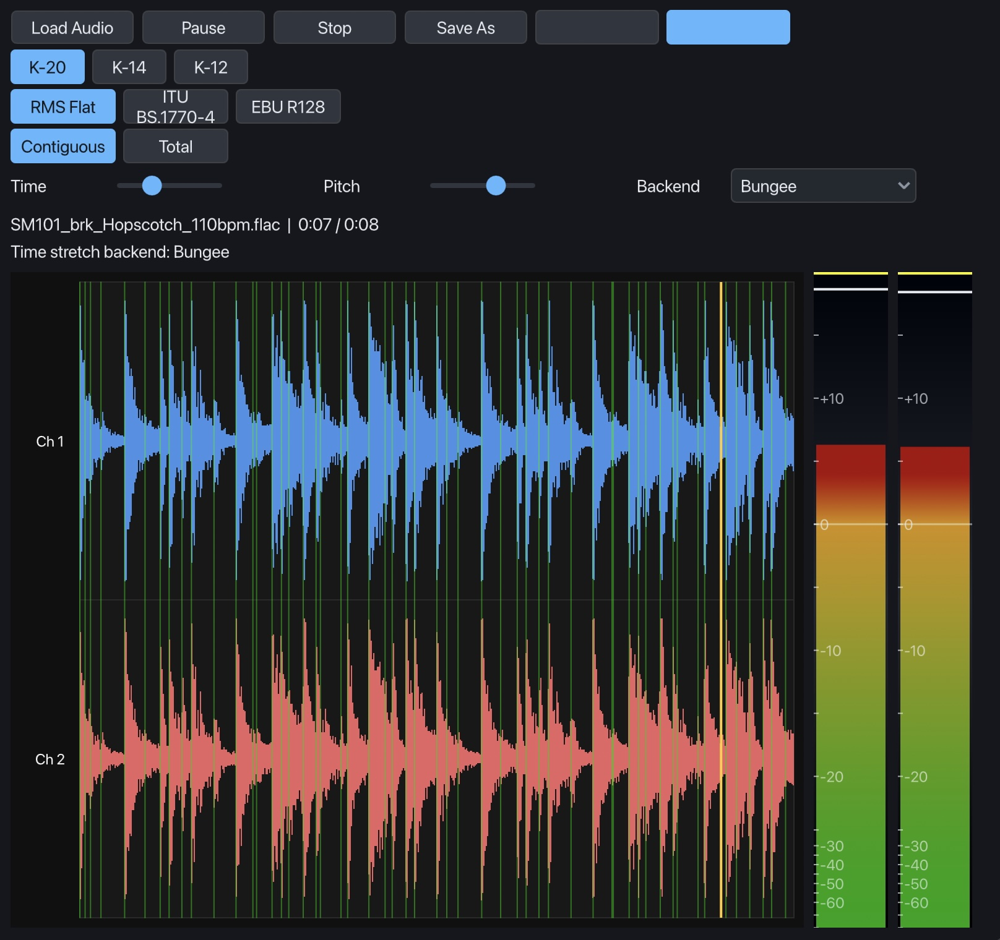
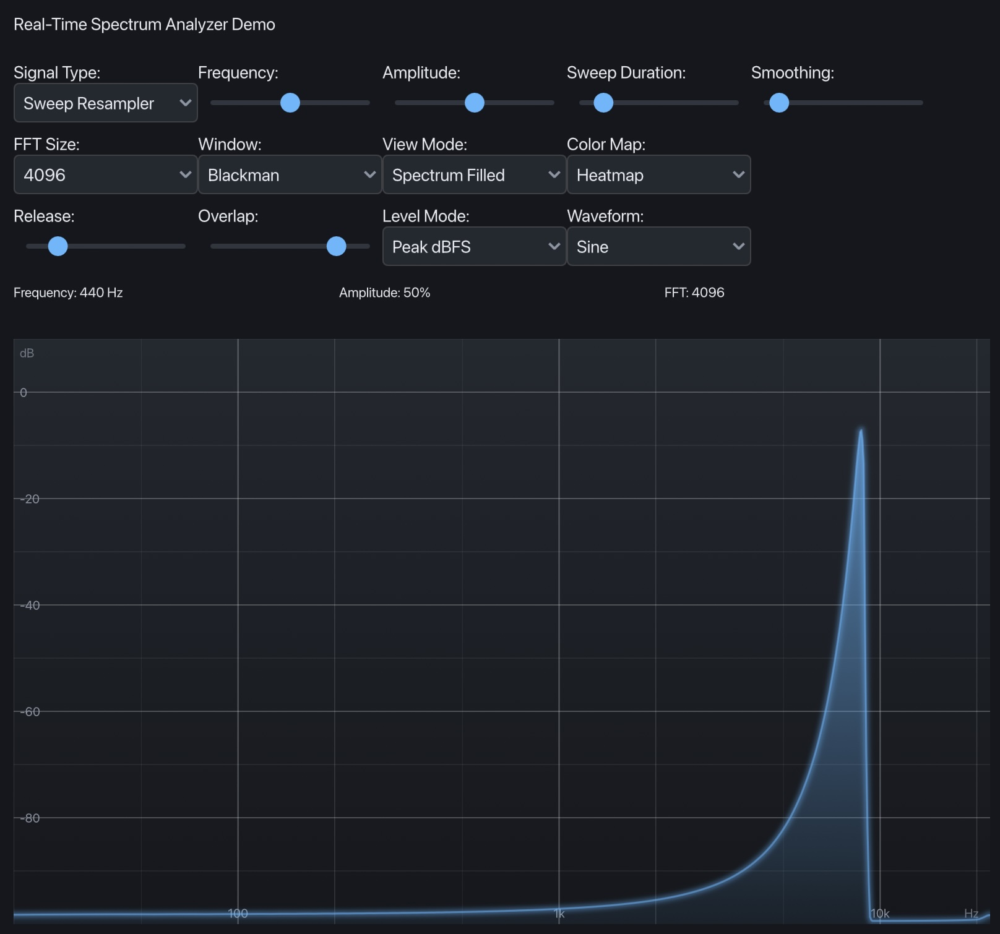
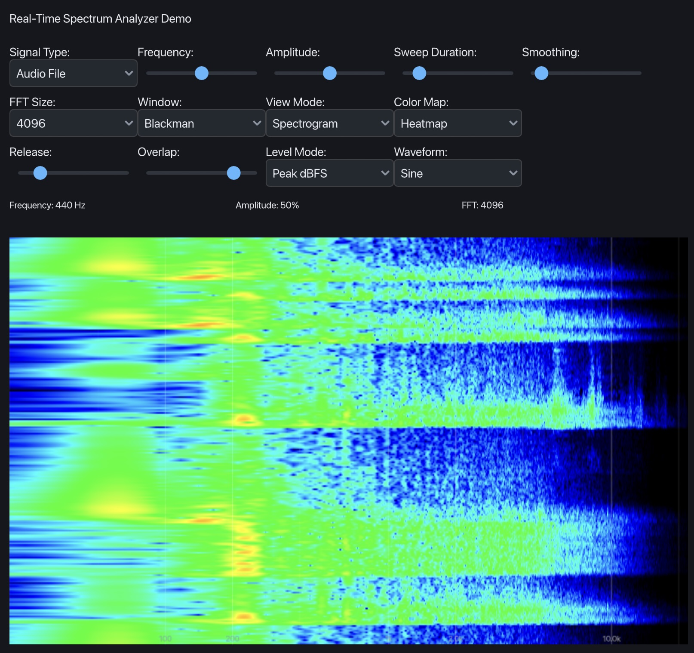

# Audio GUI

`yup_audio_gui` holds the components an audio application usually needs on
screen: device settings, level meters, waveform views, spectrum analyzers and
spectrograms, plots, a MIDI keyboard with its wheels, and the node editor of the
[audio graph](audio-graph.md). The displays read data that the audio thread
pushes into lock-free state objects, so the audio callback never touches a
component.

**Module:** `yup_audio_gui`

## Device settings

`AudioDeviceManagerPanel` lets the user pick the device type, the output and
input devices, the sample rate, the buffer size, the active channels and the MIDI
devices of an `AudioDeviceManager`. Changes are applied to the manager as soon as
the user makes them: there is no Apply button.

Embed the panel in any component, for example as a page of a settings dialog.
When you do, hold the connection returned by `makeMidiDeviceListConnection()` so
the MIDI lists follow devices being plugged in and out:

```cpp
class SettingsPage : public yup::Component
{
public:
    explicit SettingsPage (yup::AudioDeviceManager& deviceManager)
        : panel (deviceManager)
    {
        midiDeviceListConnection = panel.makeMidiDeviceListConnection();
        addAndMakeVisible (panel);
    }

    void resized() override
    {
        panel.setBounds (getLocalBounds());
    }

private:
    yup::AudioDeviceManagerPanel panel;
    yup::MidiDeviceListConnection midiDeviceListConnection;
};
```

`getPreferredHeight()` returns the height that shows every list row, and
`onPreferredHeightChanged` is called when it changes, for example after selecting
another device. Given less space, the lists shrink and scroll. Set `onClose` to
show a Close button. Once it has a parent, the panel draws itself as a rounded
card with a drop shadow.

For a standalone settings window, use `AudioDeviceManagerWindow`, which manages
the MIDI connection itself. Create it once, show it with `setVisible (true)`, and
reuse it: closing it only hides it.

```cpp
settingsWindow = std::make_unique<yup::AudioDeviceManagerWindow> (deviceManager);
settingsWindow->setVisible (true);
```

The selectors the panel is made of (`DeviceTypeSelector`, `DeviceIOSelector`,
`RateBufferSelector`, `ChannelSection` and `MidiSection`) are public too, for a
custom layout. They report the user's choices through callbacks such as
`onTypeChanged`, `onDeviceChanged`, `onChanged`, `onChannelsChanged`,
`onInputsChanged` and `onOutputChanged`, and leave applying them to you.

## Level meters

`KMeterComponent` draws a K-System meter for one channel of a `KMeterState`, or
for the loudest channel with a channel of `-1`. The state does the measuring (see
[KMeterState](dsp/dynamics.md#kmeterstate)): the audio thread pushes samples
into it and the component reads the levels at its refresh rate.

```cpp
// Members
yup::KMeterState meterState { 48000.0, 2 };
yup::KMeterComponent leftMeter { meterState, 0 };
yup::KMeterComponent rightMeter { meterState, 1 };

// Message thread
meterState.setScale (yup::KMeterState::Scale::k20);
leftMeter.setShowPeakHold (true);
rightMeter.setShowPeakHold (true);

// Audio thread
meterState.pushSamples (channelPointers, numChannels, numSamples);
meterState.processPendingAudio();
```

<p align="center">
  
  
</p>

Call `meterState.prepare (sampleRate, numChannels)` when the device sample rate
changes. The component can also:

- show or hide the peak and peak-hold markers (`setShowPeak()`,
  `setShowPeakHold()`, `setPeakHoldTime()`, where `-1` holds forever);
- use a `linear` or `segmented` scale (`setScaleMapping()`);
- choose how overs are counted (`setOverCounterMode()`);
- change the refresh rate from 10 to 60 Hz (`setRefreshRate()`, 30 by default);
- tune the average ballistics (`setAverageIntegrationTime()`,
  `setAverageFallTime()`).

`onLevelChanged (peakDb, averageDb)` and `onClippingChanged (isClipping)` report
the levels to the rest of the UI.

## Waveforms and thumbnails

`AudioViewComponent` draws a zoomable, scrollable multi-channel waveform. Give it
a buffer that outlives the view, or a reader it takes ownership of:

```cpp
// Members
std::shared_ptr<yup::AudioPeakProfileCache> waveformCache = std::make_shared<yup::AudioPeakProfileCache>();
yup::ThreadPool threadPool;
yup::AudioViewComponent waveform { waveformCache };

// Message thread
waveformCache->setThreadPool (&threadPool);

yup::AudioFormatManager formatManager;
formatManager.registerDefaultFormats();
waveform.setSource (formatManager.createReaderFor (file));
```

Instead of reading every sample at each paint, the view draws from an
`AudioPeakProfile`: peaks computed once at an adaptive resolution and aggregated
at several levels (16, 256 and 4096 by default), so any zoom level draws quickly.

- **Navigation:** `setZoomFactor()`, `setViewRangeSamples()` and
  `scrollToSample()` move the view, and `setSelectable (true)` lets the user zoom
  and scroll with the mouse and keyboard. `getHorizontalScrollBar()` and
  `getProgressBar()` give access to the child components.
- **Labels:** `setChannelLabelsVisible()` and `setLabelWidth()` control the
  channel labels.
- **Coordinates:** `sampleToX()`, `xToSample()`, `timeToSample()`,
  `sampleToTime()` and `getWaveformBounds()` convert between samples, seconds
  and pixels, for drawing markers.
- **Custom drawing:** override `paintOverlay()`, `paintBackground()`,
  `paintPlaceholder()` or `getChannelLabel()` to draw on top of the waveform or
  change its look.

<p align="center">
  
</p>

### Peak caching

`AudioPeakProfileCache` stores the peak profiles, so a file opened twice is only
analyzed once, and one cache can be shared by every view of the application:

- With `setThreadPool()`, profiles are computed in the background and the view
  shows a progress bar meanwhile. Without a pool they are computed synchronously.
- `setDiskCacheEnabled (true)` and `setCacheDirectory()` keep the profiles on disk
  between runs. `getDiskCacheSize()` and `clearDiskCache()` manage that folder.
- `getProfile (key)` looks a profile up in memory, and `requestProfile (key,
  buildFunction)` computes one when it's missing. `generateCacheKey()` makes the
  key of a file or a buffer.
- Cache listeners (`profileReady()` and `profileProgress()`) are always called on
  the message thread.

Remove the pending jobs of the pool (`threadPool.removeAllJobs (true, -1)`) before
destroying the cache. `AudioPeakProfile` can also be used on its own: build it
from a buffer or a reader, then save it with `saveToFile()` or `serialize()`.

### Thumbnails

`AudioThumbnail` holds the source and peak profile without being a component, to
share them between views or draw them in your own `paint()`. It accepts the same
sources as the view, plus buffers it copies or takes over, and its listeners hear
about `thumbnailChanged()` and `thumbnailProgressChanged()`. Override
`paintChannel()` or `getChannelColor()` to change the drawing, and pass the
thumbnail to `AudioViewComponent (thumbnail)` to show it with zooming and
scrolling.

## Spectrum analyzer

`SpectrumAnalyzerComponent` draws the frequency spectrum of a signal on a
logarithmic frequency axis. The audio thread pushes samples into a
[SpectrumAnalyzerState](dsp/frequency.md#spectrumanalyzerstate), and the
component runs the FFT on the UI thread.

<p align="center">
  
</p>

```cpp
// Members
yup::SpectrumAnalyzerState analyzerState;
yup::SpectrumAnalyzerComponent analyzer { analyzerState };

// Message thread
analyzer.setWindowType (yup::WindowType::hann);
analyzer.setFrequencyRange (20.0f, 20000.0f);
analyzer.setDecibelRange (-100.0f, 10.0f);
analyzer.setDisplayType (yup::SpectrumAnalyzerComponent::DisplayType::filled);

// Audio thread
analyzerState.pushSamples (channelData, numSamples);
```

Tell the component the sample rate when the device starts, for example from
`audioDeviceAboutToStart()` with `analyzer.setSampleRate (device->getCurrentSampleRate())`.

- **FFT:** `setFFTSize()`, `setWindowType()` and `setOverlapFactor()` set up the
  analysis. `setFFTSize()` resizes the state too; a state starts at 2048 unless
  you pass another size to its constructor.
- **Levels:** `setLevelMode()` shows peak, RMS or power decibels, or the power
  spectral density. `setReleaseTimeSeconds()` sets how fast the curve falls.
- **Refresh:** `setUpdateRate()` sets a fixed refresh rate in Hz, or `0` to follow
  the display.
- **Conversions:** `getFrequencyForBin()` and `getBinForFrequency()` convert
  between bins and frequencies.

Give each display its own `SpectrumAnalyzerState`, so that two displays fed by
the same signal don't consume each other's samples.

## Spectrogram

`SpectrogramComponent` draws the spectrum over time as a scrolling image, from a
`SpectrumAnalyzerState` fed the same way as the analyzer:

<p align="center">
  
</p>

```cpp
yup::SpectrumAnalyzerState spectrogramState;
yup::SpectrogramComponent spectrogram { spectrogramState };

spectrogram.setFrequencyRange (20.0f, 20000.0f);
spectrogram.setDecibelRange (-100.0f, 10.0f);
spectrogram.setColorMap (yup::SpectrogramColorMap::Type::heatmap);
```

Besides the analysis settings it shares with the analyzer (`setFFTSize()`,
`setWindowType()`, `setOverlapFactor()`, `setSampleRate()`), the spectrogram has:

- `setScrollSpeed()`: `1` scrolls in real time and `0` pauses.
- `setColorMap()`: `heatmap`, `grayscale`, `cool`, `warm` or `viridis`.
- `setNumHistoryFrames()`: how many frames are kept (at least 4).
- `clearHistory()`: empties the image.
- `getSpectrogramImage()`: copies the current image back from the GPU, for
  example to export it. It returns an invalid image before the first paint.

`SpectrogramColorMap` can also be used on its own to map levels to colors.

## Custom spectrum displays

To draw a spectrum yourself, `SpectrumBinMapping` maps the points of a
logarithmic frequency axis onto the FFT bins. Instead of snapping each point to
the nearest bin, which draws a staircase at low frequencies, it interpolates
levels between bins:

```cpp
yup::SpectrumBinMapping mapping;
mapping.setFftParameters (fftSize, sampleRate);
mapping.setFrequencyRange (20.0f, 20000.0f);
mapping.setNumDisplayPoints (512);

for (int point = 0; point < mapping.getNumDisplayPoints(); ++point)
    displayLevels[point] = mapping.getBandLevel (binLevels, point, yup::SpectrumBinMapping::BandAggregation::peak);
```

`getRange (point)` returns the center frequency and the fractional bin range of a
display point. The band levels can be aggregated as their `peak`, `sum` or `mean`.

## Cartesian plane

`CartesianPlane` plots signals on linear or logarithmic axes, with grid lines,
axis labels and a legend. It suits filter responses and other curves computed on
the message thread:

```cpp
plot.setTitle ("Crossover Frequency Response");
plot.setXRange (20.0, 20000.0);
plot.setXScaleType (yup::CartesianPlane::AxisScaleType::logarithmic);
plot.setYRange (-48.0, 12.0);
plot.setYScaleType (yup::CartesianPlane::AxisScaleType::linear);

plot.setVerticalGridLines ({ 20.0, 100.0, 1000.0, 10000.0, 20000.0 });
plot.setHorizontalGridLines ({ -48.0, -24.0, -12.0, 0.0, 12.0 });
plot.addHorizontalGridLine (0.0, yup::Color (0xff666666), 2.0f, true);
plot.setXAxisLabels ({ 100.0, 1000.0, 10000.0 });
plot.setYAxisLabels ({ -48.0, -24.0, -12.0, 0.0, 12.0 });

const int lowIndex = plot.addSignal ("Low", yup::Color (0xff4488ff), 2.0f);
plot.setLegendVisible (true);

std::vector<yup::Point<double>> response; // (frequency, decibels) pairs
plot.updateSignalData (lowIndex, response);
```

<p align="center">
  
  
</p>

`setMargins()` makes room for the labels, `setSignalVisible()` hides a signal,
`setLegendPosition()`, `setLegendBackgroundColor()` and `setLegendTextColor()`
place and color the legend, and `valueToX()`, `valueToY()`, `xToValue()`, `yToValue()` and `getPlotBounds()`
convert between values and pixels, for example to drag a crossover point.

## MIDI keyboard and wheels

`MidiKeyboardComponent` draws a playable piano keyboard over a
`MidiKeyboardState`. Its interaction, ranges and appearance are covered in
[MIDI keyboard](../ui/midi-keyboard.md).

<p align="center">
  
  
</p>

```cpp
// Members
yup::MidiKeyboardState keyboardState;
yup::MidiKeyboardComponent keyboard { keyboardState, yup::MidiKeyboardComponent::horizontalKeyboard };

// Audio thread: merge the notes played on screen into the block's MIDI
keyboardState.processNextMidiBuffer (midiBuffer, 0, numSamples, true);
```

`ModWheelComponent` and `PitchWheelComponent` are the wheels next to the keys.
The mod wheel reports a value from `0` to `1` and stays where it is left. The
pitch wheel reports `-1` to `1` and springs back to the center on release, unless
`setResetOnRelease (false)`. Both follow the modulation wheel (CC 1) or pitch
wheel of the `MidiKeyboardState` on the channel set with `setMidiChannel()`,
updating on the message thread, but they don't write to the state: turn
`onValueChanged` into MIDI messages yourself:

```cpp
yup::ModWheelComponent modWheel { keyboardState };
yup::PitchWheelComponent pitchWheel { keyboardState };

modWheel.onValueChanged = [this] (double value)
{
    sendMidi (yup::MidiMessage::controllerEvent (1, 1, static_cast<int> (value * 127.0)));
};

pitchWheel.onValueChanged = [this] (double value)
{
    sendMidi (yup::MidiMessage::pitchWheel (1, 8192 + static_cast<int> (value * 8191.0)));
};
```

<p align="center">
  
  
</p>

Here `sendMidi()` stands for your own way of passing messages to the audio
thread. Double-clicking a wheel restores `setDefaultValue()`,
`setMouseDragSensitivity()` changes how far a drag moves it, and `onDragStart` /
`onDragEnd` mark the gesture.

## Graph editor

`AudioGraphComponent` is a zoomable, pannable node editor for an
[audio graph](audio-graph.md). The graph model stays the source of truth: the
component draws node views and wires, and turns user gestures into requests that
your code applies to the model and commits.

```cpp
graphEditor = std::make_unique<yup::AudioGraphComponent> (graph, &undoManager);

graphEditor->onConnectionRequested = [this] (const yup::AudioGraphConnection& connection)
{
    if (model->addConnection (connection).failed())
        return false;

    if (graph->commitChanges().wasOk())
        return true;

    model->removeConnection (connection); // roll back an invalid graph
    graph->commitChanges();
    return false;
};

graphEditor->onConnectionRemovalRequested = [this] (const yup::AudioGraphConnection& connection)
{
    if (! model->removeConnection (connection))
        return false;

    if (graph->commitChanges().wasOk())
        return true;

    model->addConnection (connection);
    graph->commitChanges();
    return false;
};

addAndMakeVisible (*graphEditor);
```

Return `true` from a request to accept it:

| Callback | Requested edit |
|---|---|
| `onConnectionRequested` | The user dragged a wire between two ports. |
| `onConnectionRemovalRequested` | The user removed a wire. |
| `onEndpointConnectionsRemovalRequested` | The user cleared every wire of a port. |
| `onNodeMoveRequested (nodeID, oldPosition, newPosition)` | The user moved a node. Without this callback, the component stores the position in the model itself. |

Connections can only be edited when the connection callbacks are set. With an
`UndoManager`, accepted gestures are added to its history and the component
handles the undo and redo shortcuts while focused; undoing connections needs both
the add and removal callbacks.

Each node is drawn by a view you add with `addNodeView (nodeID, view, position)`
(and `setGraphInputView()` / `setGraphOutputView()` for the graph inputs and
outputs). Subclass `AudioGraphNodeView` to describe a node:

```cpp
class GainNodeView : public yup::AudioGraphNodeView
{
public:
    using AudioGraphNodeView::AudioGraphNodeView;

    yup::String getNodeTitle() const override { return "Gain"; }
    int getNumInputPorts() const override { return 1; }
    int getNumOutputPorts() const override { return 1; }
};

graphEditor->addNodeView (nodeID, std::make_unique<GainNodeView> (nodeID), { 100.0f, 80.0f });
```

Port indexes are the bus indexes of the node's processor. Override
`getInputPortInfo()` and `getOutputPortInfo()` to name and color the ports and set
their kind (`audio`, `midi` or `parameter`), `getNumParameterRows()` and
`getParameterInfo()` to show parameter rows, `paintNodeContent()` for custom
content, and `getNodeColor()`, `getNodeSubtitle()`, `getPreferredWidth()` and
`getPreferredHeight()` for the look.

Navigate with `setZoom()`, `setCanvasOffset()`, `resetView()`,
`centerViewOnNodes()` and `zoomToFitNodes()`, and convert positions with
`canvasToScreen()` and `screenToCanvas()`. An `AudioGraphComponent::Listener`
hears about accepted edits (`connectionAdded()`, `connectionRemoved()`,
`nodeViewMoved()`) and about `nodeDoubleClicked()`, `nodeContextMenu()` and
`canvasContextMenu()`, to open plugin editors or menus. The canvas colors are the
`backgroundColorId` and `gridColorId` style colors.

## Parameter binding

`AudioParameterBindingProvider` exposes the parameters of a processor to a
[YUI document](../ui/yui/documents.md#audio-parameters), so plugin editors written
in `.yui` can bind controls to them by ID:

```cpp
MyEditor (MyProcessor& processor)
    : params (*this, processor.getParameters())
{
    startParameterListening (processor);
    document.setModel ("params", params);
}
```

Each parameter holds its real (not normalized) value. Edits from the UI become
change gestures that the host records as automation, and read-only parameters
ignore them. The editor must outlive the provider, and parameter IDs must be
valid identifiers.

## Threading rules

| Object | Audio thread | Message thread |
|---|---|---|
| `KMeterState` | `pushSamples()`, `processPendingAudio()` | `KMeterComponent` reads the levels |
| `SpectrumAnalyzerState` | `pushSample()`, `pushSamples()` | The analyzer and spectrogram run the FFT and draw |
| `MidiKeyboardState` | `processNextMidiBuffer()` | Keyboard and wheels |
| `AudioPeakProfileCache` | Not used | Requests and listeners; profiles built on its thread pool |
| Every component | Never | Everything |

See [the audio thread](../core/multithreading/index.md#the-audio-thread) for what
the audio callback may and may not do.

## Related pages

- [Audio graph](audio-graph.md) - the model edited by `AudioGraphComponent`.
- [Plugin hosting](plugin-hosting.md) - loading the plugins shown in a graph editor.
- [Audio devices](devices.md) - the `AudioDeviceManager` behind the settings panel.
- [Audio files](audio-files.md) - readers for the waveform view.
- [MIDI](midi.md) - `MidiKeyboardState` and MIDI messages.
- [MIDI keyboard](../ui/midi-keyboard.md) - the keyboard component in detail.
- [Dynamics and metering](dsp/dynamics.md) - `KMeterState` and level measurement.
- [Frequency domain](dsp/frequency.md) - FFT and `SpectrumAnalyzerState`.
- [YUI documents](../ui/yui/documents.md) - binding UI to models, including audio parameters.
