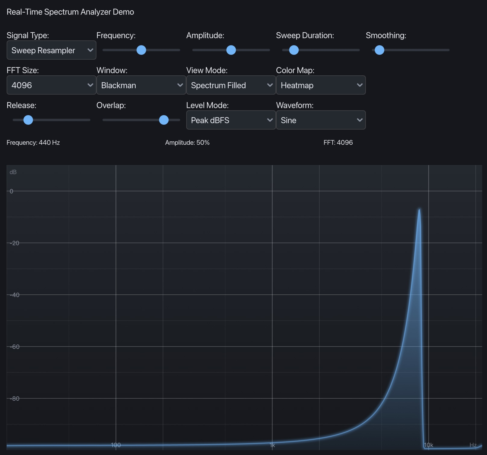

# Frequency domain

The frequency-domain layer of `yup_dsp` covers FFT processing, the realtime
spectrum-analyzer sample collection model, and the low-level Ooura FFT
implementation the module can fall back on.

<p align="center">
  
</p>

## FFTProcessor

`FFTProcessor<SampleType>` is a multi-backend FFT engine with a unified
interface, available in `float` and `double` precision. The best available
backend is selected **at compile time**, in this priority order:

1. **PFFFT** (`YUP_FFT_USING_PFFFT`)
2. **Apple vDSP** (`YUP_FFT_USING_VDSP`, via the `Accelerate` framework)
3. **Intel IPP** (`YUP_FFT_USING_IPP`)
4. **FFTW3** (`YUP_FFT_USING_FFTW3`)
5. **Ooura FFT** (`YUP_FFT_USING_OOURA`) — always-available fallback

The engine is non-copyable and move-only; `getBackendName()` reports which
backend is active (`"PFFFT"`, `"Apple vDSP"`, `"Intel IPP"`, `"FFTW3"`,
`"Ooura FFT"`, or `"Unknown"`).

### Precision

The processing precision is the template argument — `FFTProcessor<float>`
(the default) or `FFTProcessor<double>`. Each backend uses its native
double-precision path where the underlying library exposes one: PFFFT
(`pffft_` / `pffftd_`), Apple vDSP (`vDSP_…` / `vDSP_…D`), Intel IPP
(`_32f` / `_64f`) and FFTW3 (`fftwf_` / `fftw_`). The Ooura fallback ships both
precisions of its transform routines.

```cpp
FFTProcessor<float>  fftFloat  (512);   // fastest
FFTProcessor<double> fftDouble (512);   // higher precision
```

### Supported sizes and layout

FFT sizes are powers of two in `[64, 65536]`. Buffers are **interleaved
complex pairs** — `[re0, im0, re1, im1, ...]` — so an N-point complex spectrum
occupies `2 * N` sample values. The engine handles backend-specific packed
layouts (e.g. PFFFT's `[DC, Nyquist, re1, im1, ...]`, Ooura's real-DFT packing)
internally, presenting the same interleaved format to the caller for every
backend.

### Scaling

`FFTScaling` selects how transforms are normalized:

| Mode | Behavior |
| --- | --- |
| `none` | no scaling applied |
| `unitary` | forward and inverse both scaled by `1/√N` |
| `asymmetric` | forward scaled by `1/N`, inverse unscaled |

```cpp
FFTProcessor<float> fft (512);
std::vector<float> realInput (512), complexOutput (1024);

fft.performRealFFTForward (realInput.data(), complexOutput.data());  // R → C, 512 reals → 1024 samples
fft.performRealFFTInverse (complexOutput.data(), realInput.data());  // C → R

fft.performComplexFFTForward (complexInput, complexOutput);          // C → C
fft.performComplexFFTInverse (complexInput, complexOutput);

fft.setScaling (FFTProcessor<float>::FFTScaling::unitary);
fft.setSize (1024);   // re-initialize for a new power-of-two size
```

`setSize()` (re)creates the engine, so call it during initialization, not from
the audio thread. FFTW3 plans are also created during `setSize` (with
`FFTW_ESTIMATE`) rather than per transform.

### Packed real spectra

`performRealFFTForwardPacked()` and `performRealFFTInversePacked()` exchange the
real spectrum in a packed layout of N values instead of 2 * N: the DC and
Nyquist bins are real, so they share the first pair.

```
[DC, Nyquist, re1, im1, re2, im2, ..., re(N/2 - 1), im(N/2 - 1)]
```

It is the native layout of Apple vDSP and PFFFT (and Intel IPP's `Perm` format),
which run it without any conversion, and both transforms may work in place.
Values and scaling are those of the interleaved transforms. Prefer it for
spectral processing in a hot path:

```cpp
FFTProcessor<float> fft (1024);
std::vector<float> buffer (1024);   // N values: real signal in, packed spectrum out

fft.performRealFFTForwardPacked (buffer.data(), buffer.data());
const float dc = buffer[0], nyquist = buffer[1];   // bin k: buffer[2 * k], buffer[2 * k + 1]
fft.performRealFFTInversePacked (buffer.data(), buffer.data());
```

## Operations on packed spectra

`ComplexVectorOperations` (from `yup_simd`) works on packed spectra when passed
`ComplexLayout::packedReal`, so spectral code never has to special-case the
shared DC / Nyquist pair: bin `k` is at `2 * k` and `2 * k + 1`, and pair 0 is
treated as two reals. Counts are in pairs (N / 2 for a full spectrum).

| Method | Result |
| --- | --- |
| `multiply` | `dest = a * b` (convolution) |
| `multiplyConjugate` | `dest = a * conj (b)` (cross-correlation) |
| `multiplyAccumulate` | `y += a * b` |
| `magnitude`, `powerSpectrum`, `phase` | one value per pair, `dest[0]` from DC |
| `deinterleave`, `interleave` | to and from separate real and imaginary arrays |

Every operation has `float` and `double` overloads and may write over its inputs.

```cpp
FFTProcessor<float> fft (1024);   // FFTScaling::none
std::vector<float> a (1024), b (1024);

fft.performRealFFTForwardPacked (a.data(), a.data());
fft.performRealFFTForwardPacked (b.data(), b.data());
ComplexVectorOperations::multiplyConjugate (a.data(), a.data(), b.data(), 512, ComplexLayout::packedReal);
fft.performRealFFTInversePacked (a.data(), a.data());   // circular cross-correlation, times 1024
```

## SpectrumAnalyzerState

`SpectrumAnalyzerState` is the realtime-safe sample collector for spectrum
analyzers. It follows the classic split between data collection and rendering:

- **Audio thread** pushes samples with `pushSample` / `pushSamples` — lock-free
  writes through an `AbstractFifo`, no allocation.
- **UI thread** polls `isFFTDataReady()`, then pulls overlapping FFT frames with
  `getFFTData()`.

Defaults: FFT size 2048, overlap factor `0.75` (hop size 512 at 2048). The FIFO
is allocated once, when the state is created, for the largest FFT size the state
will take, and holds `4 × fftSize` samples of the current size: nothing is
allocated afterwards, so the FFT size and the overlap can change from any thread
while the audio thread pushes.

The largest size is the second argument of the constructor. Without it a state
takes every size up to `maxFftSize` (65536), which costs about 1 MB: four frames
of the largest size, at 4 bytes a sample. Give the largest size you will set to
hold less, for example 32 KB for 2048:

```cpp
SpectrumAnalyzerState anySize (2048);           // any size up to 65536: about 1 MB
SpectrumAnalyzerState upTo4096 (1024, 4096);    // starts at 1024, up to 4096: 64 KB
```

The largest size does not change afterwards, and a size above it is ignored.
`getMaxFftSize()` returns it.

```cpp
SpectrumAnalyzerState analyzer (2048);

// audio thread:
analyzer.pushSamples (buffer, numSamples);

// UI thread:
if (analyzer.isFFTDataReady())
    if (analyzer.getFFTData (fftInput.data()))
        fft.performRealFFTForward (fftInput.data(), spectrum.data());
```

Key methods:

- `pushSample (float)` / `pushSamples (const float*, int)` — audio-thread
  writes. The samples that do not fit are dropped: the audio thread never
  waits.
- `isFFTDataReady() const` — `true` when a full frame is available.
- `getFFTData (float* destBuffer)` — copies the oldest `fftSize` samples into
  `destBuffer` and advances the read position by only `hopSize`, so consecutive
  frames overlap. Returns `false` when no data is ready.
- `getFFTData (Span<float>)` - the same, for a reader that does not set the
  FFT size itself: it returns `false` when the buffer is not of the FFT size,
  as it is right after another thread changed it.
- `skipSamples (int)` - drops the oldest samples, for a reader that fell behind.
- `setOverlapFactor (float)` - overlap in `[0, 1)`, clamped to `[0.0, 0.95]`.
- `setFftSize (int)` - a power of 2 from `minFftSize` to `getMaxFftSize()`, any
  other size is ignored. The buffered samples are kept.
- `getMaxFftSize()` - the largest FFT size the state takes, the one it was
  created for.
- `reset()` - drops the buffered samples. Like the other reading methods it
  belongs to the reading side, one thread at a time.

## Related

- [Windowing](math.md) — pair `FFTProcessor` with `WindowFunctions` for
  windowed spectral analysis.
- [Onset detection](onsets.md) — `Spectrogram`, `FilterBank`, and the spectral
  flux ODFs build on the same frequency-domain machinery.
