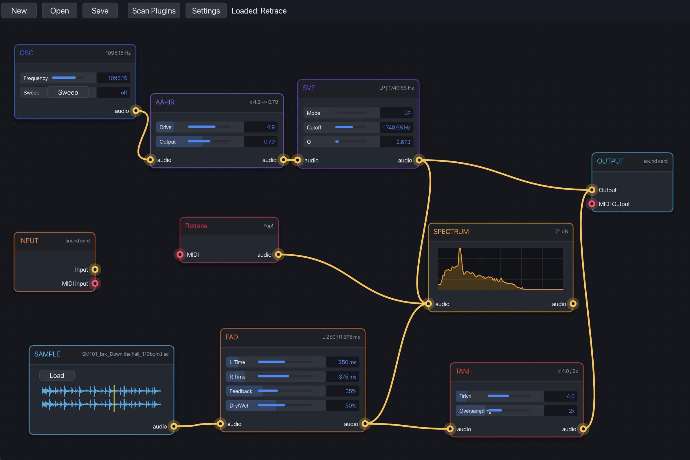
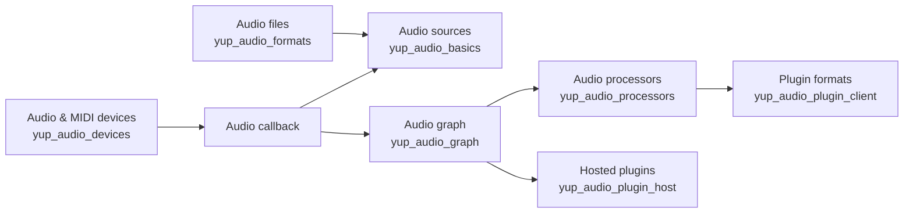

# Audio

YUP is audio-first: device I/O, MIDI 1.0 and 2.0, audio files, synthesis, an
audio processor model, a realtime audio graph, plugin hosting and plugin
wrappers all ship in the same framework, on desktop, mobile and the web.

<p align="center">
  
</p>

**Modules covered:** `yup_audio_basics`, `yup_audio_devices`,
`yup_audio_formats`, `yup_audio_processors`, `yup_audio_graph`,
`yup_audio_plugin_host`, `yup_audio_plugin_client`, `yup_audio_gui`. Signal
processing building blocks (filters, FFTs, oscillators, dynamics) live in the
[DSP](dsp/index.md) area.

## How the pieces fit



- **[Buffers](buffers.md)** and **[MIDI](midi.md)** types from
  `yup_audio_basics` are the data every other layer passes around.
- An **[audio device](devices.md)** calls your callback on the audio thread for
  every block. The callback can play **[audio sources](sources.md)** - files,
  mixers, transports - or run a **[graph](audio-graph.md)** of processors.
- An **[audio processor](processors.md)** is the unit of processing with buses,
  parameters, state and an editor. The same class becomes a plugin in every
  **[format](plugin-client.md)**, runs as a standalone app, or is a node in a
  graph next to **[hosted plugins](plugin-hosting.md)**.
- **[Audio GUI](audio-gui.md)** components display and control all of it.

## Where to start

| You want to | Start with |
| --- | --- |
| Play or generate sound in an application | [Audio and MIDI devices](devices.md), then [Audio sources](sources.md) |
| Load, play or record audio files | [Audio files](audio-files.md) |
| Build a synthesizer | [Synthesizers](synthesizers.md), [MIDI](midi.md) |
| Write a CLAP, VST3, AU, LV2 or AAX plugin | [Audio processors](processors.md), [Writing plugins](plugin-client.md) |
| Load third-party plugins in your app | [Plugin hosting](plugin-hosting.md) |
| Route processors and plugins together | [Audio graph](audio-graph.md) |
| Process audio in the frequency domain | [Spectral processing](spectral.md) |
| Support MPE controllers or MIDI 2.0 | [MPE](mpe.md), [UMP and MIDI 2.0](ump.md) |
| Show meters, waveforms, spectra or a keyboard | [Audio GUI](audio-gui.md) |
| Run in the browser | [Web audio](web.md) |

## The audio thread

Audio callbacks, `processBlock` and `getNextAudioBlock` run on the realtime
audio thread: they must not lock, allocate, do I/O or wait for other threads.
Each page states which calls are realtime-safe. The general rules, and the
lock-free patterns to talk to the UI, are in
[Multithreading: the audio thread](../core/multithreading/index.md#the-audio-thread).

## Pages

**[Fundamentals](fundamentals.md)**

- [Audio buffers](buffers.md) - `AudioBuffer`, channel layouts and sample
  format conversion.
- [Audio utilities](utilities.md) - decibels, smoothing, ADSR, reverb, IIR
  filters, interpolators and CPU load measurement.
- [MIDI](midi.md) - messages, buffers, sequences, MIDI files, keyboard state
  and microtuning.
- [UMP and MIDI 2.0](ump.md) - Universal MIDI Packets and conversion to and
  from MIDI 1.0.
- [MPE](mpe.md) - MIDI Polyphonic Expression zones, instruments and
  synthesizers.

**[Playback and I/O](playback-and-io.md)**

- [Audio and MIDI devices](devices.md) - `AudioDeviceManager`, audio
  callbacks, backends per platform and MIDI ports.
- [Audio sources](sources.md) - pull-based playback, transports and mixing.
- [Audio files](audio-files.md) - reading and writing WAV, FLAC, MP3, Ogg
  Vorbis, Opus and platform codecs.
- [Synthesizers](synthesizers.md) - polyphonic voices driven by MIDI.
- [Web audio](web.md) - the AudioWorklet device, Web MIDI and browser rules.

**[Processors and plugins](processors-and-plugins.md)**

- [Audio processors](processors.md) - the processor model, parameters, state
  and editors.
- [Spectral processing](spectral.md) - frequency-domain processors.
- [Writing plugins](plugin-client.md) - one processor as CLAP, VST3, AU, AUv3,
  LV2, AAX and standalone.
- [Plugin hosting](plugin-hosting.md) - scanning, loading and sandboxing
  third-party plugins.
- [Audio graph](audio-graph.md) - realtime routing of processors and plugins.
- [Headless audio](headless.md) - the audio engine in a console application,
  without `yup_gui`.

**[DSP](dsp/index.md)**

- [DSP](dsp/index.md) - filters, oscillators, envelopes, dynamics, FFTs,
  resampling, time-stretching and YDSP, the JIT-compiled DSP language.

**[YDSP](ydsp/index.md)**

- [YDSP](ydsp/index.md) - a realtime audio DSP language JIT-compiled to native
  code while the application runs.

**User interface**

- [Audio GUI](audio-gui.md) - device settings, meters, waveforms, spectrum
  displays, keyboards and the graph editor.

## Examples

- [audiograph](https://github.com/kunitoki/yup/tree/main/examples/audiograph) -
  a modular host with a node editor, plugin scanning and hosting.
- [plugin](https://github.com/kunitoki/yup/tree/main/examples/plugin) - a small
  polyphonic instrument, built in every format and as a standalone app.
- [Retrace](https://github.com/kunitoki/retrace) - a spectral FM synthesiser, a full plugin in a
  repository of its own.
- [graphics](https://github.com/kunitoki/yup/tree/main/examples/graphics) -
  includes audio demos: file playback, a spectrum analyzer, filters, a
  crossover, convolution and YDSP synths, each opening an audio device.

## Related

- [Building audio plugins](../build-system/building-plugins.md) - CMake
  targets, formats and installation.
- [Multithreading](../core/multithreading/index.md) - threads, locks and the
  message thread.

```{toctree}
:hidden:
:maxdepth: 2

fundamentals
playback-and-io
processors-and-plugins
dsp/index
ydsp/index
audio-gui
```
