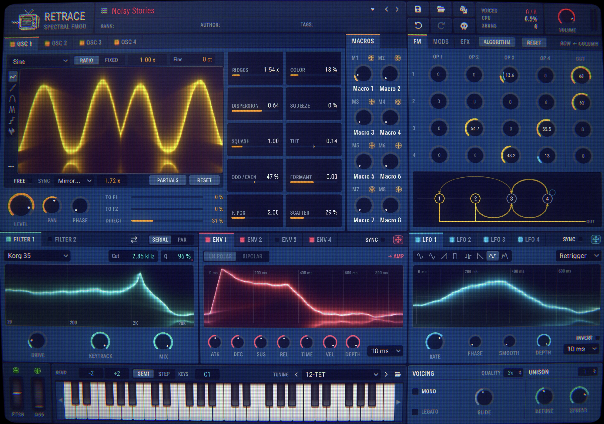

# Writing plugins

The plugin client turns one `yup::AudioProcessor` into every plugin format YUP supports: CLAP,
VST3, Audio Unit (AU and AUv3), LV2, AAX and a standalone application. You write the
processor and its editor once; thin format wrappers translate each host's API into the
processor lifecycle described in [Audio processors](processors.md). This page explains how
that translation behaves. For the CMake side (targets, identifiers, installation, the
browser build) see [Building plugins](../build-system/building-plugins.md) and the
[CMake API](../build-system/cmake-api.md).

**Module:** `yup_audio_plugin_client`

<p align="center">
  
</p>

## One processor, many formats

`yup_audio_plugin()` compiles your sources once into a shared library and links a small
wrapper target per enabled format. Every wrapper creates the processor through the same entry
point, then forwards host calls to it:

| Format | Wrapper type | Platforms | Notes |
| --- | --- | --- | --- |
| CLAP | `clap` | macOS, Windows, Linux | MIDI 2.0 note ports, modulation, remote controls |
| VST3 | `vst3` | macOS, Windows, Linux | Program list, MIDI CC mapping, parameter finder |
| AU | `au` | macOS | Factory presets, MIDI output callback |
| AUv3 | `auv3` | macOS | App extension, user presets, MIDI 2.0 per-note data |
| LV2 | `lv2` | macOS, Windows, Linux | TTL generated from the processor, in progress |
| AAX | `aax` | macOS, Windows | Requires the AAX SDK, host meters |
| Standalone | `standalone` | Desktop and browser | Own audio and MIDI device handling |

Because the processor sources are shared, the format macros reach only the wrappers. Ask the
processor at runtime instead:

```cpp
MyProcessor::MyProcessor()
    : yup::AudioProcessor ("MyPlugin", makeLayout())
{
    if (getWrapperType() == yup::AudioPluginWrapperType::standalone)
        enableDemoMode();
}
```

`getWrapperType()` is already set when the constructor runs.

## The entry point

Each plugin defines one `extern "C"` function returning a new processor. The wrappers own the
returned object.

```cpp
extern "C" yup::AudioProcessor* createPluginProcessor()
{
    return new MyProcessor();
}
```

The function name comes from the `YUP_AUDIO_PLUGIN_CREATE_FUNCTION` module option, which
defaults to `createPluginProcessor`. A host may create several instances in one process, so
keep per-instance data in the processor, not in globals.

## Parameters across formats

Every format sees the same parameter list, built with `AudioParameterBuilder`. The parameter's
host ID (`withHostID()`, or its index when none is given) becomes the CLAP parameter ID, the
VST3 `ParamID`, the AU `AudioUnitParameterID` and the LV2 parameter URI suffix.

```{warning}
Hosts store parameter IDs in sessions and automation lanes, so changing them breaks existing
projects. Give each parameter an explicit host ID and never change or reuse it. AAX identifies
parameters by their position, so also keep the order: append new parameters at the end and
leave retired ones in place (for example as read-only).
```

Other builder settings map to format features where they exist:

| Setting | Formats |
| --- | --- |
| `withModulatable`, `withPerNoteModulatable` | CLAP modulation, globally or per note |
| `withModulePath` | VST3 units, CLAP modules, AU clumps |
| `withCategory` (meters) | AAX host meters, read-only parameters elsewhere |
| `withBypass` | Host bypass control in every format |
| `withUnit`, `withStepped`, `withEnum` | Units, steps and value lists in each host's display |

Host automation arrives in two forms in `processBlock`: the last value of the block is stored
in the parameter before the call, and every change is listed with its sample offset in
`context.params`. CLAP modulation is only in `context.params`. See
[Sample-accurate automation](processors.md#sample-accurate-automation).

## State compatibility

Every format saves the processor state through `saveStateIntoMemory()` and restores it with
`loadStateFromMemory()`, so the bytes your processor writes are identical in all formats.
CLAP, VST3, AUv3, LV2 and AAX wrap them with the wrapper bypass state; state saved without that
header is still loaded. The standalone application stores the same bytes in its settings file.

To keep old sessions loading:

- Version your state (for example a `version` property in the `DataTree`) and read missing
  properties with defaults.
- Restore parameters by their string ID, not by index.
- Return `yup::Result::fail()` for data you cannot read rather than applying part of it.

## MIDI and note expressions

All formats deliver MIDI in `context.midi` when the processor has a MIDI input bus, and send the
MIDI left in it when the processor has a MIDI output bus.

| Format | Per-note expressions |
| --- | --- |
| CLAP | Native note expressions |
| VST3 | Native note expressions |
| AUv3 | MIDI 2.0 per-note pitch bend and controllers, converted to expressions |
| AU, LV2, AAX, standalone | None, MIDI only |

Return true from `supportsNoteExpression()` to receive them in `context.noteExpressions`.
Otherwise wrappers convert them to MIDI, channel-wide or as MPE when `supportsMpe()` is true.
VST3 hosts can also map MIDI controllers to parameters through
`getParameterIndexForMidiController()`.

## Bypass, latency and presets

- **Bypass**: the host bypass control is the processor's `withBypass()` parameter, or one added
  by the wrapper. While bypassed, wrappers call `processBlockBypassed()` instead of
  `processBlock`.
- **Latency and tail**: `setLatencySamples()` and `getTailSamples()` are reported to the host,
  and wrappers tell the host when `updateHostDisplay()` flags a change.
- **Presets**: the processor presets become the VST3 program list and the AU and AUv3 factory
  presets.
- **Suspension**: wrappers skip or silence a block when the processor is suspended or its process
  lock is held, so reconfiguring under `ScopedProcessSuspension` is safe in every format.
- **Denormals**: every wrapper, the standalone included, calls `processBlock` and
  `processBlockBypassed()` with denormals disabled (flush-to-zero, plus denormals-are-zero on
  Intel CPUs, nothing in the browser) and restores the floating point mode of the host thread
  afterwards.

[Host integration](../build-system/building-plugins.md#host-integration) lists the
format-specific details of each feature.

## Editors in hosts

The wrapper creates the editor with `createEditor()` when the host opens the plugin window,
sizes it with `getInitialSize()` and destroys it when the window closes, which can happen many
times during the processor's life. Keep everything the user would expect to survive in the
processor.

Editor sizes are always in YUP points; wrappers convert to and from the physical pixels some
hosts use. Resizable editors get a resize corner from the wrapper, and every host resize goes
through `getConstrainedSize()`. See
[Resizable editors](../build-system/building-plugins.md#resizable-editors).

`getHostContext()` gives the editor host services when the format offers them, such as the
host parameter context menu in VST3 and CLAP.

## Host detection and quirks

`yup::AudioProcessor::getHostType()` identifies the host application from its name and
executable, for example to work around a host bug:

```cpp
if (yup::AudioProcessor::getHostType().isBitwigStudio())
    useWorkaround = true;
```

The wrappers already handle known quirks, such as FL Studio overlapping processing with
activation in VST3. `isValidator()` is true under auval and pluginval, which exercise the
plugin harder than any host. The host type is unknown in the standalone application.

## The standalone wrapper

The standalone format runs the processor as an application with its own audio and MIDI
device handling:

- **Player**: the processor is prepared for the device sample rate and buffer size, and device
  blocks are split so `processBlock` never receives more than the prepared size. The play head
  is `nullptr`.
- **MIDI**: every enabled MIDI input and the on-screen keyboard feed `context.midi`; MIDI the
  processor produces goes to the selected MIDI output (desktop only).
- **Window**: a toolbar with the settings panel and, for synths and MIDI processors, a keyboard,
  above the editor or a placeholder when there is none. Aspect ratio constraints are kept.
- **State**: device setup, processor state and window bounds are saved when the settings close
  and when the application quits, then restored on the next launch.

From the editor, `yup::StandalonePluginHost::getInstance()` returns the host (and `nullptr` in
every other format) to hide the toolbar or open the settings from your own UI. See
[Standalone application](../build-system/building-plugins.md#standalone-application) for the
storage location and the browser build.

## Debug logging

Each wrapper can log its host interaction (lifecycle calls, state, parameter events) to
the debug output. Enable it per format with the module options
`YUP_ENABLE_PLUGIN_CLIENT_CLAP_LOGGING`, `YUP_ENABLE_PLUGIN_CLIENT_VST3_LOGGING`,
`YUP_ENABLE_PLUGIN_CLIENT_AU_LOGGING`, `YUP_ENABLE_PLUGIN_CLIENT_AUV3_LOGGING`,
`YUP_ENABLE_PLUGIN_CLIENT_LV2_LOGGING` and `YUP_ENABLE_PLUGIN_CLIENT_AAX_LOGGING`, all off by
default.

## Related pages

- [Audio processors](processors.md) - the processor, parameters, state and editor the wrappers host
- [Spectral processing](spectral.md) - shipping an FFT based effect as a plugin
- [Plugin hosting](plugin-hosting.md) - the other direction: loading plugins in your application
- [Building plugins](../build-system/building-plugins.md) - CMake setup, standalone and installation
- [CMake API](../build-system/cmake-api.md) - every `yup_audio_plugin` option
