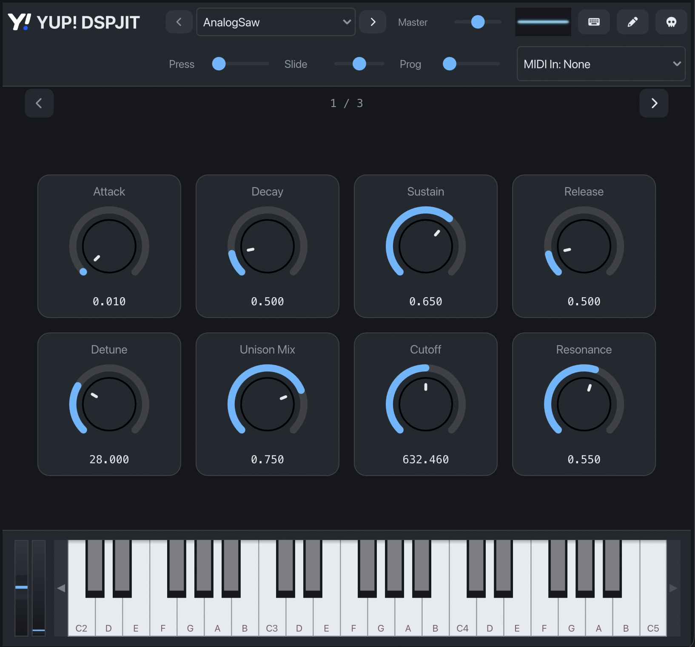

# YDSP - the JIT-compiled DSP language

**YDSP** is a realtime audio DSP language, compiled by the `yup_dsp_jit` module
straight to native AArch64 and x86-64 code, and to WebAssembly with SIMD in the
browser. A `.ydsp` file declares `processor` kernels and composes them into
`graph` signal flows; the compiler turns that into an allocation-free function
the audio thread calls.

<p align="center">
  
</p>

**Modules covered:** `yup_dsp_jit`, with the `asmjit_library` and
`sleef_library` third-party modules and the `yup_dsp_compiler` host tool.

## Why a language

The [`yup_dsp`](../dsp/index.md) classes are C++ building blocks you assemble by
hand, recompiling for every change. YDSP trades that for text the application
compiles at runtime: a patch can be edited while it plays, shipped as a
precompiled `.ydsb` bundle, and composed out of subgraphs with automatic delay
compensation - things that are tedious to maintain as C++ templates.

Both live side by side: a `YdspAudioGraph` is just another processor inside an
audio graph, next to filters, dynamics and oscillators written in C++.

## In this area

- [Language reference](language.md) - program structure, `processor` and
  `graph` definitions, the Faust-style composition algebra, the type system,
  intrinsics, the realtime contract, the public C++ API, diagnostics and
  project manifests.
- [Optimization](optimization.md) - the compile options that steer vectorization
  and numerics, fast math, portable targets, and how to read the optimization
  report.
- [Compiler and player](command-line.md) - the `yup_dsp_compiler` host tool:
  building bundles, listing audio and MIDI devices, playing a patch, hot
  reloading, and the editor diagnostics mode behind the VS Code extension.
- [Bundle format](bundle-format.md) - the RIFF `YDSP` container that carries a
  patch's editable source closure, metadata and diagnostics, and the CMake
  helper that embeds one.

## Related areas

- [DSP](../dsp/index.md) - the C++ processing blocks YDSP patches sit next to.
- [Audio graph](../audio-graph.md) and [processors](../processors.md) - what hosts a
  compiled patch.
- [Code editor](../../ui/code-editor.md) - the `CodeEditor` component, which
  has a built-in YDSP `SyntaxDefinition`.

```{toctree}
:hidden:
:maxdepth: 1

language
optimization
command-line
bundle-format
```
