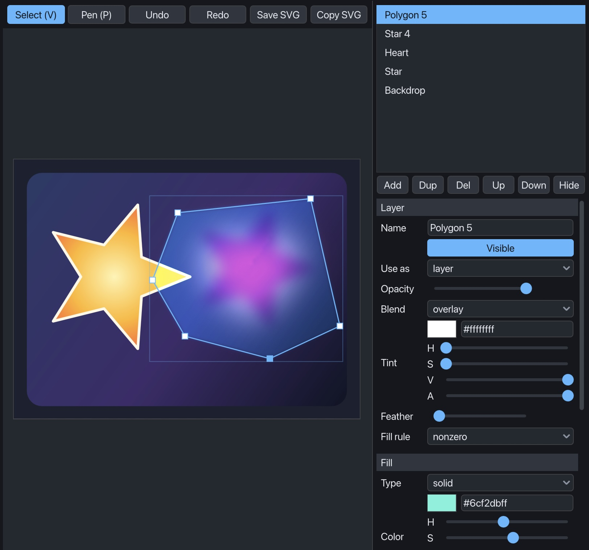

# Graphics

The graphics stack renders 2D vector content and GPU-accelerated scenes across
Metal, Direct3D, OpenGL / OpenGL ES, WebGL and WebGPU (WASM / Emscripten), and Vulkan.
It is built on the open source [Rive](https://rive.app/) renderer.

<p align="center">
  
</p>

**Modules covered:** `yup_rhi`, `yup_graphics`, `yup_shading`, `yup_animation`.

## In this area

- [Primitives](primitives.md) - `Point`, `Rectangle`, `Color`, `ColorGradient`,
  `Path`, `AffineTransform`, `StrokeType`, `BlendMode` - the value types every
  drawing call consumes - plus `Vector3`, `Matrix4`, `Quaternion`, `Ray` and `MeshSurfaceMapper`
  for 3D.
- [The Graphics class](graphics-class.md) - the immediate-mode 2D drawing API:
  state model, fills, strokes, text, images, transforms, clipping, transparency
  layers, and offscreen rendering.
- [How to draw](drawing.md) - a task-oriented guide with copy-paste examples for
  common drawing patterns: backgrounds, buttons, text, paths, gradients, and more.
- [Fonts & text layout](fonts.md) - the `Font` resource, variable-font axes,
  OpenType features, `StyledText`, and themed font access.
- [Drawables & SVG](svg.md) - parsing and painting SVG with `Drawable`, fitting
  modes, and custom image/font resolvers.
- [Graphics expressions](expressions.md) - graphics types for the expression
  language and `ExpressionDrawing` for data-driven shapes.
- [RHI - GPU Rendering Hardware Interface](rhi/index.md) - the backend-agnostic
  low-level GPU layer: frames, render passes, pipelines, buffers, textures, and
  offscreen targets.
- [Platforms](platforms/index.md) - the GPU backends: Metal, Direct3D, Vulkan,
  OpenGL / OpenGL ES, WebGPU and headless, what each supports, and how a window
  chooses one.

Bitmap image handling - creating, loading, saving, and drawing images - has its
own [Imaging](../imaging/index.md) area.

## Key building blocks

The `yup_graphics` and `yup_rhi` modules provide:

- **`GpuDevice`** (`yup_rhi`) - a reference-counted GPU device abstraction that
  owns the native GPU device and command queue without requiring a window.
  Created via `GpuDevice::create(GpuPlatform, Options)`. Supports
  `GpuPlatform::Metal`, `Direct3D`, `OpenGL`, `OpenGLES`, `WebGPU`, `Vulkan`, and `Headless`
  (see [Platforms](platforms/index.md)).
  Use `GpuDevice` directly for GPU compute (e.g. audio DSP on the GPU) — no window needed.
- **`GraphicsContext`** (`yup_graphics`) - wraps a `GpuDevice` and adds the
  window/swapchain layer plus Rive vector rendering. Created via
  `GraphicsContext::createContext(GpuPlatform, Options, GpuDevice::Ptr = {})`.
  When an existing `GpuDevice::Ptr` is provided, it shares the GPU device
  (useful when an audio processor already owns one).
- **`Graphics`** - the immediate-mode 2D drawing API (fills, strokes, paths,
  gradients, text, images, textures).
- **Primitives** - points, rectangles, sizes, affine transforms, and colors.
  Geometry primitives use the templated `.to<float>()` conversion, not `toFloat`.
- **Drawables, fonts, SVG, and image formats** for higher-level content.

```{note}
YUP uses American English: it is `Color` (not `Colour`) and `center` (not `centre`).
```

## Related areas

- [UI](../ui/index.md) - `Component` painting and windowing that drive the
  graphics context.
- [Component paint profiling](../ui/component-profiling.md) - measuring
  paint cost.
- [Imaging](../imaging/index.md) - bitmap images: loading, saving, pixels and
  drawing.
- [Animation](../animation/index.md) - Lottie animations drawn with `Graphics`.
- [3D](../3d/index.md) - scenes, meshes and glTF rendered through the RHI.

```{toctree}
:hidden:
:maxdepth: 2

primitives
graphics-class
drawing
fonts
svg
expressions
rhi/index
platforms/index
```
