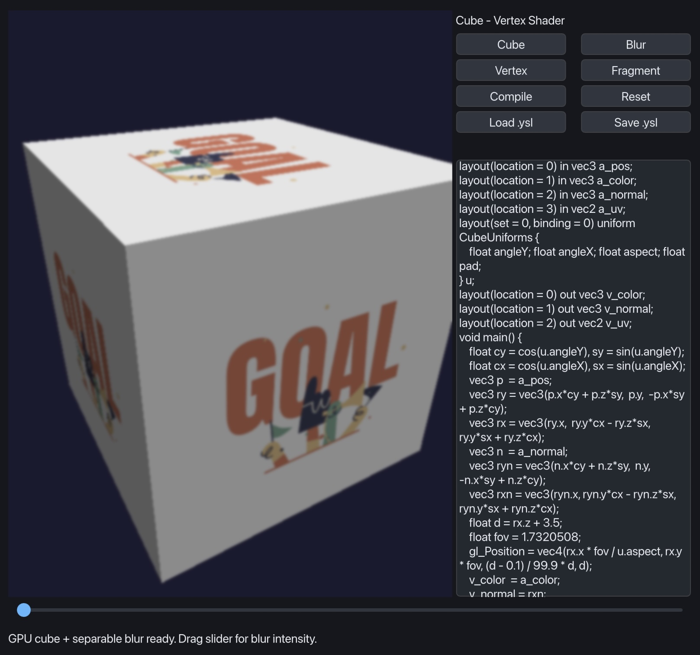

# Walkthrough: The Spinning Cube

This walkthrough ties the RHI together with an end-to-end example: a spinning 3D
cube rendered with a custom pipeline, textured with a live animation, and passed
through a separable Gaussian blur post-process.

The complete, runnable source lives in the graphics example under
[`examples/graphics/source/examples/SpinningCube.h`](https://github.com/kunitoki/yup/blob/main/examples/graphics/source/examples/SpinningCube.h).
Drag the cube to spin it (a flick keeps its momentum), scroll or pinch to blur it,
double-click to reset, and drop a Lottie file on it to change its texture.



## What it demonstrates

- Custom 3D geometry: per-vertex position / color / normal in a `GpuBuffer`,
  drawn with `drawIndexed()` and backface culling.
- A per-frame MVP transform pushed as a uniform buffer on the render pass.
- Pipelines created from precompiled shader bundles via `GpuPipeline::compileFromBundle()`.
- An offscreen 2D `GpuCanvas` used as an animated texture, sampled by the cube's
  fragment shader.
- A two-pass separable Gaussian blur post-process built from a second
  `GpuPipeline`, sharing one `GpuFrame`.

## 1. Probe for GPU support

Everything below requires a GPU context. Bail out early if it is missing:

```cpp
if (! ctx.isGpuAvailable())
{
    statusLabel->setText ("GPU context unavailable", dontSendNotification);
    return;
}
```

## 2. Compile the cube pipeline

The cube uses a vertex + fragment shader pair, precompiled at build time into a
`.ysl` shader bundle embedded in the app:

```cpp
GpuPipelineOptions options;
options.vertexBuffers.push_back (cubeLayout);  // position/color/normal/uv
options.indexFormat          = GpuIndexFormat::uint16;
options.cullMode             = GpuCullMode::back;
options.winding              = GpuFaceWinding::counterClockwise;
options.depthStencil.enabled = true;

auto bundle = ShaderBundle::loadFromData (ShaderBundleFile_data, ShaderBundleFile_size);
if (bundle.failed())
    return;

auto result = GpuPipeline::compileFromBundle (device, bundle.getReference(), options);
if (result.wasOk())
    cubePipeline = result.getValue();
```

See [Pipelines & shaders](pipelines.md) for the vertex layout and options in
detail, including [`compileFromGlsl()`](pipelines.md) for compiling GLSL at runtime,
and [`GpuPipelineCache`](pipelines.md#gpupipelinecache) to cache pipelines.

## 3. Upload the geometry once

The cube's vertices and indices never change, so they live in immutable buffers
created once (not per frame):

```cpp
cubeVerts   = GpuBuffer::create (ctx, GpuBufferType::vertex, verts,   sizeof verts);
cubeIndices = GpuBuffer::create (ctx, GpuBufferType::index,  indices, sizeof indices);
```

## 4. Render the animated texture

The moving texture mapped onto each face is drawn with the 2D API into an
offscreen `GpuCanvas`, then handed to the cube shader as a texture:

```cpp
auto& g = textureCanvas->beginDraw();
// ... draw the current animation frame with g ...
auto animatedTexture = textureCanvas->asTexture(); // auto-commits the 2D frame
```

## 5. Encode the scene pass

Each frame, begin a `GpuFrame`, open a render pass on the scene canvas, bind the
pipeline + per-frame uniforms + geometry, and issue an indexed draw:

```cpp
auto frame = GpuFrame::begin (device);

auto pass = sceneCanvas->beginRenderPass (frame, { true, Colors::black });
pass.setPipeline (cubePipeline);
pass.setUniformBuffer (0, 0, &mvp, sizeof mvp); // per-frame transform
pass.setTexture (0, 1, animatedTexture);
pass.setVertexBuffer (0, cubeVerts);
pass.setIndexBuffer (GpuIndexFormat::uint16, cubeIndices);
pass.drawIndexed (cubeIndexCount);
pass.finish();
```

## 6. Apply the blur post-process

The blur is a fullscreen pipeline (no vertex buffers). A separable Gaussian runs
as two passes - horizontal then vertical - sharing the same frame. Each pass
samples the previous result and generates its vertices from the vertex index:

```cpp
GpuRenderOptions load { false, Colors::transparentBlack };

auto hPass = blurCanvasH->beginRenderPass (frame, { true, Colors::transparentBlack });
hPass.setPipeline (blurPipeline);
hPass.setTexture (0, 0, sceneCanvas->asTexture());
hPass.setUniformBuffer (0, 2, &horizontalParams, sizeof horizontalParams);
hPass.draw (3);
hPass.finish();

auto vPass = blurCanvasV->beginRenderPass (frame, { true, Colors::transparentBlack });
vPass.setPipeline (blurPipeline);
vPass.setTexture (0, 0, blurCanvasH->asTexture());
vPass.setUniformBuffer (0, 2, &verticalParams, sizeof verticalParams);
vPass.draw (3);
vPass.finish();

frame.submit();
```

## 7. Composite to screen

Finally, draw the blurred result back into the component's 2D graphics:

```cpp
g.drawTexture (blurCanvasV->asTexture(), getLocalBounds());
```

## Takeaways

- **Compile once, render many.** Pipelines and static geometry buffers are
  created up front; only uniform data and bindings change per frame.
- **One frame, many passes.** Chain the scene pass and both blur passes into a
  single `GpuFrame` before submitting.
- **Textures are the glue.** `asTexture()` moves results between passes and back
  into the 2D `Graphics` API without CPU readback.

## See also

- [Concepts & lifecycle](concepts.md)
- [Frames & render passes](frames-and-passes.md)
- [Pipelines & shaders](pipelines.md)
- [Offscreen targets & canvases](targets.md)
