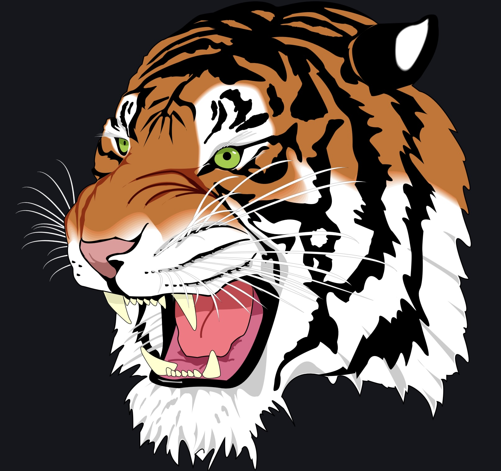

# Drawables & SVG

`Drawable` parses and paints SVG content into a `Graphics` context. It is the
high-level entry point for vector artwork; the underlying parsed model is an
`SVGDocument`, and fitting/positioning reuses the shared `Fitting` and
`Justification` enums.

<p align="center">
  
</p>

## Drawable

A `Drawable` holds a parsed SVG document and knows how to render it. Parse once,
paint many times.

### Parsing SVG

From a file or from an in-memory string:

```cpp
Drawable drawable;

if (drawable.parseSVG (File ("/path/to/icon.svg")))
{
    // ready to paint
}

// or from text
drawable.parseSVG (R"(<svg viewBox="0 0 24 24"><circle cx="12" cy="12" r="10"/></svg>)");
```

`parseSVG` returns `true` on success. Call `clear()` to reset the drawable.

### Painting

The simplest form paints at the drawable's natural bounds using the current
`Graphics` transform:

```cpp
void MyComponent::paint (Graphics& g) override
{
    drawable.paint (g);
}
```

The fitted form scales and positions the artwork within a target rectangle:

```cpp
drawable.paint (g,
                getLocalBounds().to<float>(),
                Fitting::scaleToFit,
                Justification::center);
```

### Fitting modes

`Fitting` controls how the artwork is scaled into the target area:

| Mode            | Behavior                                                        |
| --------------- | --------------------------------------------------------------- |
| `none`          | No scaling.                                                      |
| `scaleToFit`    | Scale proportionally to fit inside (no cropping). **Default.**   |
| `fitWidth`      | Match width, preserve aspect ratio.                             |
| `fitHeight`     | Match height, preserve aspect ratio.                            |
| `scaleToFill`   | Scale proportionally to fill (may crop).                        |
| `fill`          | Stretch to fill (aspect ratio not preserved).                   |
| `tile`          | Repeat to fill.                                                 |
| `centerCrop`    | Like `scaleToFill`, keeping the center visible.                 |
| `centerInside`  | Like `scaleToFit`, but never upscales beyond original size.     |
| `stretchWidth`  | Stretch horizontally, preserve vertical size.                   |
| `stretchHeight` | Stretch vertically, preserve horizontal size.                   |

An SVG whose root element has a `preserveAspectRatio` attribute is fitted the
way it asks for, whatever `fitting` and `justification` are passed.

<p align="center">
  
  
</p>

### Querying bounds

```cpp
Rectangle<float> bounds = drawable.getBounds();
```

Use the bounds to size a component or to compute an aspect-correct target area.

## SVGDocument & parse options

`Drawable::parseSVG` accepts a `ParseOptions` struct (aliased as
`Drawable::ParseOptions`) that controls how external references - images and
fonts - are resolved during parsing.

```cpp
Drawable::ParseOptions options;
options.baseDirectory    = File ("/assets/icons");  // resolves relative hrefs
options.allowDataImages  = true;                     // permit data: URIs
options.allowLocalImages = true;                    // permit local file hrefs

drawable.parseSVG (svgFile, options);
```

Local image hrefs are confined to `baseDirectory`: absolute paths, drive or
scheme prefixes, `..` components and symbolic links are rejected, so an
untrusted SVG cannot read files outside it.

### Custom image resolver

Supply your own loader to intercept `<image>` hrefs - useful for virtual file
systems or embedded resources. Return `std::nullopt` to fall back to the default:

```cpp
options.imageResolver = [] (StringRef href, const File& baseDir) -> std::optional<Image>
{
    if (auto bytes = loadEmbeddedAsset (href))
        return Image::loadFromData (*bytes).getValue();

    return std::nullopt; // use default resolution
};
```

### Custom font resolver

SVG `<text>` elements resolve fonts through a resolver keyed by CSS font
properties. Return `std::nullopt` to use the default font lookup:

```cpp
options.fontResolver = [] (StringRef family, float size, int weight, bool italic)
    -> std::optional<Font>
{
    if (family == "Brand")
        return brandFont.withHeight (size);

    return std::nullopt;
};
```

`weight` follows CSS conventions (400 = normal, 700 = bold); `italic` is true for
italic or oblique styles.

## Supported SVG features

The parser handles a broad subset of SVG, including:

- Shapes and paths, with fills, strokes, dash arrays, and markers.
- Linear and radial gradients (`SVGGradient`).
- Clip paths (`SVGClipPath`) and masks (`SVGMask`).
- Patterns (`SVGPattern`) for tiled fills.
- Filters (`SVGFilter`), run on the GPU: `feGaussianBlur`, `feOffset`, `feFlood`,
  `feColorMatrix`, `feComposite`, `feBlend`, `feMorphology`, `feMerge`,
  `feDiffuseLighting` and `feSpecularLighting` (distant and point lights),
  `feDisplacementMap`, `feDropShadow`, and the functions of a CSS `filter`
  (`blur`, `drop-shadow`, `brightness`, `contrast`, `grayscale`, `hue-rotate`,
  `invert`, `opacity`, `saturate`, `sepia`). See [filters](#filters).
- Text elements (with the font resolver above).
- Embedded and referenced images (with the image resolver above).
- CSS styling via `<style>` rules (`SVGCssRule`).
- `viewBox` with `preserveAspectRatio` fitting and justification.

```{note}
For direct access to the parsed model - elements, gradients, and bounds - an
`SVGDocument` exposes its `SVGData` through `visit()`. Most applications only
need `Drawable`; reach for `SVGDocument` when building custom SVG tooling.
```

## Filters

An element with a `filter` is painted into an offscreen raster covering the
region of the filter, at the resolution it has on screen. The primitives run on
it as a [`FilterGraph`](graphics-class.md#filtered-content), and the result is
painted with the opacity, the blend mode, the clip and the mask of the element.
The raster is kept, so a filter only runs again when the SVG is painted larger.

- The region (`x`, `y`, `width`, `height`, `filterUnits`), `primitiveUnits`,
  the `in` / `in2` / `result` names and `color-interpolation-filters` are
  honored. What a primitive puts outside the region is cut off, as in a browser.
- `feTurbulence` and `feImage` make nothing (transparent black), and
  `feComponentTransfer`, `feConvolveMatrix` and `feTile` leave their input as it
  is. A spot light is lit as a point light, the `x`, `y`, `width` and `height`
  of single primitives are ignored, and `FillPaint` and `StrokePaint` are empty.
- `BackgroundImage` is empty too, except in a filter ending with an `feBlend`
  of what it made and `BackgroundImage`: that blend becomes the blend mode the
  element, or its filtered picture, is painted with.
- Text has no bounding box for a filter to cover, so a filter on a `<text>`
  alone is not run. Only the blend above applies to it.
- A blur has one deviation: the largest of the two of `stdDeviation`.
- Without a GPU the element is painted without its filter.

## Editing an SVG as a drawing

A `Drawable` paints an SVG as it is. To bind its shapes to the properties of a
component, animate them or edit them, `YuiSvgImporter` (in `yup_gui`) writes the
SVG as a [`.yui` drawing](../ui/yui/drawing.md#importing-an-svg) made of native
shapes, painting what the `Drawable` paints:

```cpp
const auto imported = YuiSvgImporter::importSvg (File ("logo.svg"));

if (imported.wasOk())
    File ("logo.yui").replaceWithText (imported.toText());

for (const auto& warning : imported.warnings)
    DBG (warning);                                // what the drawing paints differently
```

Groups keep their structure and set the paint their shapes share, gradients
become named values, and `<use>`, patterns, markers, clip paths, masks, filters,
nested `<svg>` elements, images and text become the matching elements of the
drawing.

## See also

- [Data-driven drawing](../ui/yui/drawing.md) - the drawing language an SVG is imported into.
- [The Graphics class](graphics-class.md) - the context `Drawable` paints into.
- [Images](../imaging/index.md) - how SVG `<image>` hrefs become `Image` objects.
- [Fonts & text layout](fonts.md) - how SVG `<text>` resolves fonts.
