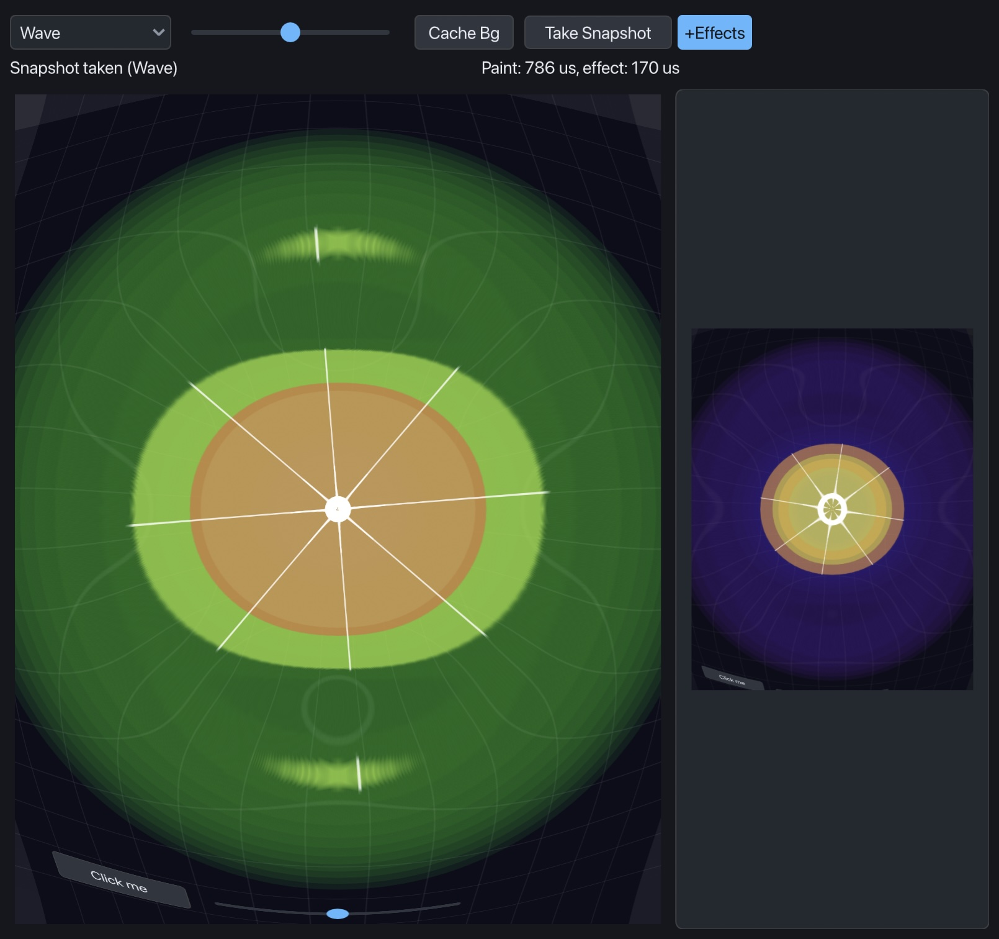

# Component Effects (Shaders)

This guide explains how to apply GPU shader effects to a `Component` and its
subtree: with a `ShaderEffect`, which runs a fragment shader as it is, or with
a subclass of the `ComponentEffect` base class.

## Overview

A `ComponentEffect` renders the component subtree into an offscreen GPU texture,
then applies a post-processing shader before compositing the result back. This
enables visual effects such as blurs, edge detection, pixelation, colour
adjustments, and custom GLSL pipelines without modifying the component's
`paint()` code.

<p align="center">
  
</p>

Effects are reference-counted and can be shared across multiple components.
When a component has an active effect, the rendering path automatically:

1. Renders the entire subtree (self + children + `paintOverChildren`) to an
   offscreen `GpuCanvas`.
2. Calls `ComponentEffect::apply()` with the input texture and destination
   bounds.
3. The effect draws its result into the main `Graphics` context.

Where the canvas can't be made, without a GPU or for a component larger than a
texture of the device can be, the component is painted directly, without its
effect. An effect with nothing to apply tells so by returning `false` from
`isActive()`: its component is then painted directly too, with no canvas, and
its points are not mapped. Repaint the component when that value changes.

Nested effects compose naturally: a child's effect completes before the parent's
effect captures the subtree, so a parent blur will blur an already-edged child.

The input texture is at device-pixel resolution: its size is the destination
`bounds` multiplied by the display scale (2× on a Retina display). Size
texel-space parameters such as blur radii or pixel block sizes from the texture,
not from `bounds`. The subtree is rendered at full opacity and the component's
opacity is applied once, when the effect draws into `g`.

The texture also holds the [paint margin](component-basics.md#paint-margin) of
the component, so what it paints around its bounds goes through the effect, and
an effect such as a drop shadow has room to draw past them. Stylesheet `shadow:`
and `glow:` layers are part of the texture too. The destination `bounds` are
then the local bounds grown by the margin, up to the whole units and pixels
around it, and start at a negative position: draw into `bounds`, not into a
rectangle at the origin.

A margin that shrinks keeps the texture it has, so a margin that is animated
allocates nothing once it has been at its largest. `bounds` stay as large as the
texture, and what the effect draws past the paint bounds is still cut.

---

## Shader Effects

An effect that is one fragment shader needs no subclass. `ShaderEffect` runs a
[`GpuImageShader`](../graphics/rhi/image-shaders.md) over what the component
painted, and fills the uniform block of the shader from the properties of the
component, by name:

```cpp
auto shader = yup::GpuImageShader::createFromData (data, size);    // a .ysl bundle, or GLSL with the transpiler

if (shader.wasOk())
{
    display.setComponentEffect (new yup::ShaderEffect (display, shader.getValue(), { { "intensity", yup::ComponentProperty::Type::number },
                                                                                      { "tint", yup::ComponentProperty::Type::color } }));

    display.setProperty ("intensity", 0.4);
    display.setColor ("tint", yup::Colors::orange);
}
```

```glsl
#version 450

layout(set = 0, binding = 0) uniform Parameters
{
    vec4 tint;          // the property tint: sRGB, not multiplied by its alpha
    float intensity;    // the property intensity
    vec2 resolution;    // filled by the effect: the size of the picture in pixels
} params;

layout(set = 0, binding = 1) uniform texture2D source;
layout(set = 0, binding = 2) uniform sampler sourceSampler;

layout(location = 0) in vec2 uv;
layout(location = 0) out vec4 color;

void main()
{
    vec4 pixel = texture (sampler2D (source, sourceSampler), uv);
    vec4 tint = vec4 (params.tint.rgb * params.tint.a, params.tint.a);    // multiplied by its alpha, as the picture is

    color = mix (pixel, pixel * tint, params.intensity);
}
```

- Each property named is a `ShaderProperty`, a name and a type. It is read with
  `Component::findProperty()` at every paint,
  so what sets it drives the shader and repaints the component: a stylesheet
  rule, a transition, a binding or `setProperty()`. The shader only runs again
  when a value it reads, a series or what the component painted changed: a
  paint that changes none of them draws the picture it made last.
- A `number`, an `integer` and a `boolean` fill a scalar, a `color` a `vec4`
  (or a `vec3`), a `point` a `vec2`, a `rectangle` a `vec4`, and an array of
  numbers an array or a vector.
- The effect fills `resolution`, `scale` (the pixels a unit takes) and `time`
  (the seconds the component has been showing for) when the block has them and
  no property takes their name. A shader with `time` is drawn again at every
  frame of its window, over what the component painted last: the component and
  its children are not painted again for it. It takes those frames from the
  paint that draws it, until the component is hidden or the shader can't be
  drawn, so a window showing nothing of it has no frame to run.
- The constructor checks nothing: a property it can't write is ignored.
  `ShaderEffect::checkProperties (*shader, properties)` tells what is wrong
  with them before the effect is made: a type a uniform can't take, a name the
  block does not have, a member too small, or a member named `resolution`,
  `scale` or `time` that is something else than what the effect fills it with.
- An effect reads the properties of the component it was created for: create
  one for each component. They can share the `GpuImageShader`.
- Where the shader can't be drawn, the component is drawn as it is: without a
  shader, without a GPU, or with a shader the device can't compile. The effect
  is then not active, so the component takes no offscreen canvas, and a shader
  with `time` stops taking the frames of its window.
- What the device refused is logged when it is found, and kept:
  `getDrawError()` returns it, empty while the shader is drawn. A stylesheet
  styling the component reports it at the `shader` block.

In a `.yui` document the same effect is a `shader` block that a rule selects
with `effect:`, with nothing to write in C++, see
[Shaders](yui/shaders.md#as-the-effect-of-a-component). An effect that needs
several passes, or a pipeline of its own, is a subclass:

---

## Step 1 — Subclass `ComponentEffect`

```cpp
#include <yup_gui/yup_gui.h>

class MyEffect final : public yup::ComponentEffect
{
public:
    void setParam (float value)
    {
        // The components the effect is set on are drawn through it again, without being painted again
        if (std::exchange (param, value) != value)
            invalidate();
    }

    void apply (yup::Graphics& g,
                yup::GpuTexture::Ptr inputTexture,
                yup::Rectangle<float> bounds) override
    {
        // Create a GpuPipeline lazily (compile once, reuse forever).
        if (pipeline == nullptr)
        {
            auto result = yup::GpuPipeline::compileFromGlsl (
                g.getGraphicsContext(), kVertSource, kFragSource, {});
            if (result.failed())
                return;
            pipeline = result.getValue();
        }

        // Apply the effect via a single render pass.
        yup::GpuTarget::Ptr target = yup::GpuTarget::create (
            g.getGraphicsContext(),
            inputTexture->getWidth(),
            inputTexture->getHeight());

        if (target == nullptr)
            return;

        auto frame = yup::GpuFrame::begin (g.getGraphicsContext());
        {
            struct Params { float p0, resX, resY, pad; };
            Params p { param,
                       (float) inputTexture->getWidth(),
                       (float) inputTexture->getHeight(), 0 };

            auto pass = target->beginRenderPass (
                frame, { true, yup::Colors::transparentBlack });
            pass.setPipeline (*pipeline);
            pass.setTexture (0, 0, inputTexture);
            pass.setUniformBuffer (0, 2, &p, sizeof (p));
            pass.draw (3);           // fullscreen triangle
            pass.finish();
        }
        frame.submit();

        g.drawTexture (target->asTexture(), bounds);
    }

    // What is kept from one apply() to the next belongs to the device of the window
    void releaseResources() override
    {
        pipeline = nullptr;
    }

private:
    float param = 8.0f;
    yup::GpuPipeline::Ptr pipeline;

    static constexpr const char* kVertSource = R"glsl(#version 450
void main() {
    float x = float((gl_VertexIndex & 1u) << 2u) - 1.0;
    float y = float((gl_VertexIndex & 2u) << 1u) - 1.0;
    gl_Position = vec4(x, y, 0.0, 1.0);
}
)glsl";

    static constexpr const char* kFragSource = R"glsl(#version 450
layout(set = 0, binding = 0) uniform texture2D u_tex;
layout(set = 0, binding = 1) uniform sampler   u_samp;
// ... your shader code ...
)glsl";
};
```

```{note}
All effects use the same vertex shader (a fullscreen triangle generated from
`gl_VertexIndex`). You only need to write the fragment shader for your effect.
```

An effect that keeps GPU objects from one `apply()` to the next (pipelines,
targets, textures, or the `GpuDevice` itself) overrides `releaseResources()` to
let go of them. They belong to the device of a window, and a component calls it
for its effect when it leaves that window: when it is removed from its parent,
and before the window is destroyed. The next `apply()` makes them again, for
the device it is then given. The built-in effects do so.

An effect tells the components it is set on when what it draws changed: its
setters call `invalidate()` when the value they are given is not the one the
effect has. Each of those components is then drawn through `apply()` again at
its next frame, over the rendering it kept: neither it nor its children are
painted again. Who uses the effect has nothing to call, neither on the effect
nor on the components.

- Call it on the message thread, or with the message manager locked, as
  `Component::repaint()`. Never call it from `apply()`.
- An effect set on no component asks for nothing, so setters can be called
  before the effect is attached.
- A component the effect is not active on is painted again as it is.
- `invalidate()` is public, for what an effect reads without being told. An
  effect that wraps another one is the one its component knows: call its
  `invalidate()` when the effect it wraps changed.

---

## Step 2 — Attach the Effect to a Component

```cpp
auto effect = yup::ReferenceCountedObjectPtr<MyEffect> (new MyEffect());
myComponent.setComponentEffect (effect);
```

To remove the effect:

```cpp
myComponent.setComponentEffect (nullptr);
```

---

## Built-in Effects in `yup_gui`

`yup_gui` ships ready-to-use `ComponentEffect` classes so common post-processing
needs no custom GLSL:

| Class | Purpose | Main parameters |
|---|---|---|
| `BlurEffect` | Two-pass separable Gaussian blur | `radius` in logical points |
| `DropShadowEffect` | Blurred alpha-silhouette shadow behind the sharp subtree | `color`, `radius`, `offset` in logical points |
| `GlowEffect` | Additive tinted bloom composited with the sharp subtree | `radius`, `intensity` (`0..1`), `color` |
| `ColorMatrixEffect` | 4x5 RGBA color-matrix transform with CSS/SVG presets | `Matrix`, or `grayscale`, `sepia`, `invert`, `saturate`, `brightness`, `contrast`, `hueRotate`, `opacity` |
| `FilterEffect` | Ordered chain of CSS `<filter-function>` operations | `blur`, `brightness`, `contrast`, `drop-shadow`, `grayscale`, `hue-rotate`, `invert`, `opacity`, `saturate`, `sepia` |
| `ShaderEffect` | A fragment shader of your own, see [Shader Effects](#shader-effects) | The properties of the component the shader reads |

```cpp
// Attach a built-in C++ effect directly:
myCard.setComponentEffect (new yup::DropShadowEffect (yup::Color (0x66000000), 8.0f, { 0.0f, 4.0f }));

// Or parse a CSS filter chain in C++:
if (auto ops = yup::FilterEffect::parse ("hue-rotate(90deg) brightness(115%)"); ops.wasOk())
    myCard.setComponentEffect (new yup::FilterEffect (ops.getValue()));
```

Changing a parameter of an effect shows by itself, with nothing to call on the
component: the effect has the components it is set on drawn through it again,
which costs the effect and not the painting of the component.

```cpp
auto blur = yup::ReferenceCountedObjectPtr<yup::BlurEffect> (new yup::BlurEffect (2.0f));
panel.setComponentEffect (blur);

blur->setRadius (6.0f); // the panel shows it at its next frame, and is not painted again
```

<p align="center">
  
  
</p>

An effect set from C++ gets no room on its own, and what it draws past the
[paint bounds](component-basics.md#paint-margin) of the component is cut. A
blur, a drop shadow or a glow spreads three times its radius on every side, and
a drop shadow its offset further, so give the component that margin:

```cpp
card.setComponentEffect (new yup::DropShadowEffect (yup::Color (0xaa000000), 5.0f, { 0.0f, 5.0f }));
card.setPaintMargin (20.0f); // three times the radius, and the offset
```

<p align="center">
  
  
</p>

### Using Effects from `.yui` Stylesheets

Stylesheets separate built-in CSS filter chains from application-defined effects:

- **`filter:`** configures an internal `FilterEffect` layer directly from CSS
  `<filter-function>` syntax, supports live `.yui` expressions for scalar and
  color arguments, automatically expands the component's paint margin for
  `blur(...)` and `drop-shadow(...)` outsets, and animates smoothly through
  `transition:` and `@keyframes`.
- **`effect:`** runs the `shader` block of that name through a `ShaderEffect`,
  see [Shaders](yui/shaders.md), or else looks up a custom effect factory by
  name in `ComponentEffectRegistry`. Either way it calls `setComponentEffect`,
  so both `filter:` and an `effect:` can be active on the same component:

```cpp
yup::ComponentEffectRegistry::getInstance().registerEffect ("crtScan", []
{
    return yup::ComponentEffect::Ptr (new CrtScanEffect());
});
```

```yui
style {
    .screen {
        effect: crtScan;
        filter: contrast(110%) saturate(120%);
        transition: filter 200ms easeOut;
    }

    .screen:disabled {
        filter: grayscale(100%) opacity(60%);
    }
}
```

See [Stylesheets in `.yui`](yui/styles.md#shadows-glows-filters-effects-and-cursors)
for full syntax and animation rules.

---

## Custom Effect Examples

The [graphics example](https://github.com/kunitoki/yup/tree/main/examples/graphics) demonstrates several reusable
effect patterns implemented as `ComponentEffect` subclasses. Each lives in
`examples/graphics/source/examples/ComponentEffects.h`, with its fragment shader
precompiled from `examples/graphics/data/shaders/effect_*.frag`. The demo applies
them, the built-in effects or a CSS filter chain to a component that paints
around its bounds, and lets you change its paint margin, cache it to a texture
and give it a stylesheet `shadow:`, `glow:` and `filter:`:

| Effect | Shader | Parameter |
|---|---|---|
| Blur | Separable Gaussian (2-pass) | sigma |
| Pixelate | Block downsample | block size |
| Edge Detect | Sobel operator | threshold |
| Wave | Sinusoidal displacement | amplitude |
| Sharpen | Unsharp-mask kernel | strength |
| CRT Scan | Scanlines + vignette | intensity |

All single-pass effects share a `SinglePassEffect` base that handles pipeline
compilation, target resizing, and draw call boilerplate. The two-pass blur is
slightly different because it needs ping-pong `GpuTarget` objects for the
horizontal and vertical passes.

```{tip}
Extract your pipeline setup into a shared helper so each effect only provides a
fragment shader string and a parameter struct.
```

---

## Effect + Caching Interaction

When both `setCachedToTexture(true)` and `setComponentEffect(...)` are set on
the same component, the **effect takes priority**: the subtree is rendered
offscreen and the effect runs over it on every frame, as it can change from one
frame to the next. What is kept between frames is the rendering of the subtree,
see [Repainting Under an Effect](#repainting-under-an-effect).

A cached component keeps what it paints in its paint margin too, the texture
holds it. Its children are not in the texture: they are painted over it.

If you need a cached background with an effect applied **only to the
background** (not the children), set `setCachedToTexture(true)` on the
background component and place animated children inside it. The children will
still repaint every frame on top of the cached (un-effected) background.

---

## Repainting Under an Effect

The effect itself always runs over the whole component, since a warp or a blur can
move or spread any pixel. The subtree it runs on is not repainted every time: the
offscreen canvas keeps the last rendering. When nothing inside changed, the subtree
is not painted at all and the effect runs over the previous rendering, whatever the
component: that is what happens when something repaints over or under it, or when
its window paints the area again.

When something inside repainted, only that is painted again over what was kept,
clipped to those areas. That needs every dirty pixel to be covered again from the
bottom up, so it applies when the component is opaque (and paints all of its bounds,
as opaque components must) and clipped. A transparent component, one with a style set
on it or one with unclipped rendering repaints its whole subtree once something in it
repainted. So does a resized canvas, a paint margin that changes, a repaint that
reaches into it, or a pixel the bounds cover in part only: nothing opaque covers those
again. A window that renders continuously repaints everything at every frame.

So keep the component with the effect opaque, and repaint only what changes: a meter
that repaints its own bounds costs the meter, not the interface under the effect.

What was kept is painted again when the component or something inside it calls
`repaint()`, is resized, is shown again or is enabled or disabled, and when the theme
changes. The `repaint()` of a parent alone does not reach it: a component that paints
with a value it takes from a parent, such as an inherited property or color, has to
be repainted itself when that value changes.

A change of the effect itself paints nothing again: the effect is drawn again over
the rendering that was kept. The effects of the library do so when one of their
parameters is set, a `ShaderEffect` whose shader has `time` at every frame, and an
effect of your own by calling `invalidate()` in its setters, as the one of Step 1 does.

## Input Mapping for Distorting Effects

An effect that moves pixels (a wave, a lens, a zoom) displays the subtree
somewhere else than where it was laid out, so pointer input has to be mapped
back. Override `displayToContent()` with the same per-pixel mapping the shader
computes for its sample coordinate, and `contentToDisplay()` with its inverse:

```cpp
class ZoomEffect : public yup::ComponentEffect
{
public:
    void apply (Graphics& g, GpuTexture::Ptr input, Rectangle<float> bounds) override
    {
        zoom = currentZoom;  // publish what is drawn for the input mapping
        // ... draw input zoomed around the center ...
    }

    std::optional<Point<float>> displayToContent (Point<float> p, Rectangle<float> bounds) const override
    {
        const auto center = bounds.getCenter();
        return center + (p - center) / zoom.load();
    }

    std::optional<Point<float>> contentToDisplay (Point<float> p, Rectangle<float> bounds) const override
    {
        const auto center = bounds.getCenter();
        return center + (p - center) * zoom.load();
    }

private:
    std::atomic<float> zoom { 1.0f };
    float currentZoom = 2.0f;
};
```

- `displayToContent()` routes hit-testing, mouse and drag-and-drop events.
  `contentToDisplay()` backs `localToScreen()` and what is built on it, like popup
  placement and the text input caret rectangle. Without it, the identity is used
  as an approximation.
- Both run on the message thread and `apply()` on the render thread, but never
  at the same time (see [Threading](component-basics.md#threading)): the atomic
  above only matters when yet another thread sets the parameters. Map with what
  the last `apply()` drew with, which keeps input consistent with what is on
  screen.
- Return a point even when it falls outside the bounds, so a captured drag keeps
  tracking. Return `std::nullopt` only for degenerate mappings: hit-testing then
  skips the component, and other conversions fall back to its position.
- Both get the `bounds` the effect is drawn into when the component is painted:
  the local bounds grown by the paint margin.
- Repainting anything inside a component with an effect runs the effect over the
  whole component again, since the effect can move pixels anywhere inside it.
- When an animated effect moves content under a pointer that stays still, the
  window re-checks the pointer after each painted frame and sends the
  enter / exit, move or drag events the new mapping implies, so hover and
  captured drags follow the animation.

The `Wave` effect of `ComponentEffectsDemo` mirrors its GLSL sampling on the CPU
this way.

---

## Related

- [Component caching](component-caching.md)
- [Component snapshots](component-snapshots.md)
- [Components in 3D](component-3d.md) — present a live component on a mesh
- [Image shaders](../graphics/rhi/image-shaders.md) - `GpuImageShader` and
  `ShaderUniforms`, what a `ShaderEffect` draws with
- [Shaders in `.yui`](yui/shaders.md) - shader effects declared in a document
- [RHI pipelines](../graphics/rhi/pipelines.md) — `GpuPipeline` and
  `GpuRenderPass` details
- [Graphics `drawTexture`](../graphics/graphics-class.md)
- [`SpinningCubeDemo`](https://github.com/kunitoki/yup/tree/main/examples/graphics) — full blur post-process
  example with live shader editing
