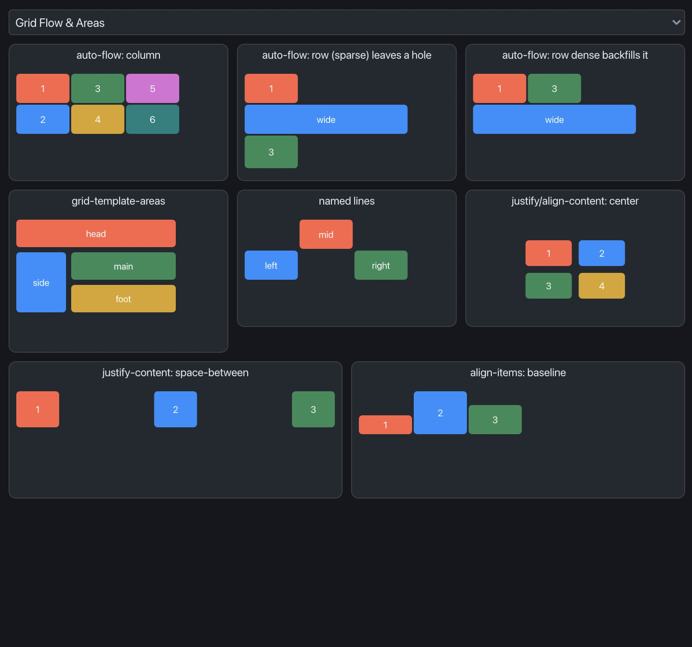

# Layout

YUP ships two layout containers modelled on the CSS layout algorithms:
`FlexBox` for one-dimensional runs of components and `Grid` for
two-dimensional track-based placement. Both take a rectangle and call
`Component::setBounds` on the components they were given; neither owns anything
or holds a reference beyond the call.

If you know CSS flexbox and CSS grid, you know these. The rest of this page is
about how they are spelled in C++ and where YUP deliberately differs.

<p align="center">
  
</p>

## The shape of a layout

A container is a plain value you fill in and hand a rectangle:

```cpp
void MyComponent::resized()
{
    yup::FlexBox box;
    box.flexDirection = yup::FlexBox::Direction::row;
    box.gap = 8.0f;

    box.items.add (yup::FlexItem (sidebar).withWidth (200.0f));
    box.items.add (yup::FlexItem (content).withFlex (1).withFlexBasis (0));

    box.performLayout (getLocalBounds());
}
```

<p align="center">
  
  
</p>

Nothing is retained, so rebuilding the container on every `resized()` is the
normal thing to do. If a layout is expensive to describe, keep the container as
a member and only call `performLayout` in `resized()` — but be aware that
`items` holds raw `Component*`, so a stored container must be rebuilt whenever
a child is added or removed.

A `Component&` or `Component*` converts implicitly to a `FlexItem` or
`GridItem`, so `box.items.add (child)` works when you want the defaults.

## Sizes are `-1` for auto

Every size and constraint field uses **`-1` to mean "not set"**, and `0` means a
genuine zero. This applies to `FlexItem::width`, `height`, `flexBasis`,
`flexBasisPercent`, the percentage fields, and all four min/max constraints, as
well as the equivalents on `GridItem`.

```cpp
yup::FlexItem (child)                     // auto on both axes
yup::FlexItem (child).withWidth (100.0f)  // 100 wide, auto tall
yup::FlexItem (child, 100.0f, 0.0f)       // 100 wide, genuinely 0 tall
```

An `auto` size falls back to the component's **current bounds**. YUP has no
content-measurement hook on `Component` yet, so there is nothing better to fall
back to — see [What is not CSS](#what-is-not-css).

The same convention covers the gap shorthands: `FlexBox::rowGap` /
`columnGap` and `Grid::rowGap` / `columnGap` are `-1` when unset, meaning "use
the `gap` shorthand". Reading one of those fields therefore gives you the
*override*, not the effective gap — take `gap` into account if you need the
value that will actually be used.

## FlexBox

The container properties mirror CSS one for one: `flexDirection`, `flexWrap`,
`justifyContent`, `alignItems`, `alignContent`, `gap` / `rowGap` /
`columnGap`, and a `padding` edge spacing.

```cpp
yup::FlexBox box;
box.flexDirection = yup::FlexBox::Direction::column;
box.flexWrap = yup::FlexBox::Wrap::wrap;
box.justifyContent = yup::FlexBox::JustifyContent::spaceBetween;
box.alignItems = yup::FlexBox::AlignItems::center;
box.setPadding (12.0f); // or box.padding = yup::EdgeSpacing<float> (12.0f, 6.0f);
box.gap = 8.0f;
```

`padding` is an [`EdgeSpacing<float>`](../graphics/primitives.md#edgespacing);
`FlexItem::margin` and `GridItem::margin` use the same type, so a per-edge
margin is `item.margin = yup::EdgeSpacing<float> (left, top, right, bottom)` or
`yup::FlexItem (c).withMargin (spacing)`.

### Flexible sizing

`flexGrow`, `flexShrink` and `flexBasis` behave as CSS §9.7 specifies,
including the freeze-and-loop: an item that hits its `maxWidth` while growing
freezes there and the space it could not take is redistributed over the rest,
rather than being left as a hole.

The idiom you want most of the time is `flex: 1 1 0` — equal shares regardless
of content:

```cpp
box.items.add (yup::FlexItem (a).withFlex (1).withFlexBasis (0));
box.items.add (yup::FlexItem (b).withFlex (1).withFlexBasis (0));
```

Leaving the basis at auto instead makes each item start from its current width,
which is rarely what you meant and is not stable across relayouts.

### Alignment

`alignItems: stretch` is the default and stretches items whose cross size is
auto to fill the line. An item with an explicit cross size keeps it and sits at
the cross start.

<p align="center">
  
  
</p>

In a single-line (`Wrap::noWrap`) container the line spans the container's
whole cross size and `alignContent` does not apply at all — that is what makes
the default stretch actually fill. `alignContent` does apply to a wrapping
container, even one that happens to produce a single line.

`spaceAround` puts a half share at each edge and a full share between;
`spaceEvenly` puts an equal share everywhere including the edges.

<p align="center">
  
  
</p>

### Auto margins

An auto margin absorbs its share of the free space on its axis, and it does so
*before* `justifyContent` is consulted. This is the toolbar idiom:

```cpp
box.items.add (yup::FlexItem (fileMenu));
box.items.add (yup::FlexItem (editMenu));
// everything below is pushed to the right-hand end
box.items.add (yup::FlexItem (settings).withAutoMargins (true, false, false, false));
```

<p align="center">
  
  
</p>

Auto margins on both sides center an item. On the cross axis an auto margin
positions the item within its line and suppresses stretching, since an item
whose margin is going to absorb the leftover cannot also be sized to fill it.

## Grid

A grid is a list of column and row tracks plus items placed into them.

```cpp
yup::Grid grid;
grid.templateColumns.add (yup::Grid::TrackInfo::px (200));
grid.templateColumns.add (yup::Grid::TrackInfo::fr (1));
grid.templateRows.addArray (yup::Grid::repeat (3, yup::Grid::TrackInfo::px (48)));
grid.gap = 8.0f;

grid.items.add (yup::GridItem (header).withColumn (0).withRow (0).withColumnSpan (2));
grid.items.add (yup::GridItem (body).withColumn (1).withRow (1));
grid.performLayout (getLocalBounds());
```

<p align="center">
  
  
</p>

### Tracks

A track is a min/max pair, exactly as in CSS. The familiar single-value forms
are just pairs:

| Factory | Equivalent to | Meaning |
|---|---|---|
| `TrackInfo::px (n)` | `minmax(n, n)` | a fixed length |
| `TrackInfo::percent (n)` | `minmax(n%, n%)` | a share of the container's size on that axis |
| `TrackInfo::fr (n)` | `minmax(0, n fr)` | a share of the leftover space |
| `TrackInfo::auto_()` | `minmax(autoRows, autoRows)` | the container's `autoRows` / `autoColumns` |
| `TrackInfo::minmax (a, b)` | — | `a`'s minimum with `b`'s maximum |
| `TrackInfo::fitContent (n)` | `minmax(0, n)` | clamped at `n` |

Percentages resolve against the container's **full** size, so two 25% columns
in a 300px grid are 75px wide whatever the gap is. Fractional tracks divide up
what is left **after** the fixed tracks and the gaps, so a gapped `fr` grid
fits its container exactly.

<p align="center">
  
  
</p>

`minmax (px (100), fr (1))` is the combination `fr` alone cannot express: take
a share of the leftover, but never drop below 100px. When the shares would come
out below the floor, the affected tracks freeze there and the remainder is
redistributed.

`repeat (count, track)` and `repeatToFill (track, size, gap, defaultSize)`
build repeated templates; the latter is CSS's `repeat(auto-fill, ...)`.

### Placement

Items are placed with 0-based `column` / `row` plus `columnSpan` / `rowSpan`,
or left at `GridItem::autoPlace` to be positioned automatically. An axis can be
set independently, so an item may pin its row and let the grid choose its
column.

Placement runs in the CSS order: every explicitly positioned item is reserved
first, then items locked to a row pick a column within it, then the rest flows
from a cursor. An auto-placed item therefore never lands on a cell that an
explicitly placed item further down the list owns.

`autoFlow` controls the direction and density of that flow. A `dense` flow
restarts the cursor for each item so it can backfill holes a larger item left
behind; the default sparse flow never goes backwards.

### Named lines and areas

```cpp
grid.setTemplateAreas ({ "header header",
                         "side   main",
                         "side   footer" });

grid.items.add (yup::GridItem (headerBar).withArea ("header"));
grid.items.add (yup::GridItem (sidebar).withArea ("side"));
```

<p align="center">
  
  
</p>

`setTemplateAreas` returns a `Result`: it fails if the rows have different cell
counts or if a name does not form a solid rectangle. A `.` marks a cell that
belongs to no area, and auto-placed items are free to use it.

Lines can also be named individually with `setColumnLineName` /
`setRowLineName` and used through `GridItem::withColumnStart` /
`withRowStart`. An unknown name is ignored and the item falls back to its
numeric placement.

## Layout components

`FlexBox`, `Grid` and `StackLayout` are algorithms you run yourself, usually
from `resized()`. The layout *components* wrap them, so a container positions
its children on its own and markup can describe a layout without any C++:

| Component | Markup name | Algorithm |
|---|---|---|
| `FlexBoxComponent` | `FlexBox` | `FlexBox` |
| `RowComponent` | `Row` | `FlexBox`, direction `row` |
| `ColumnComponent` | `Column` | `FlexBox`, direction `column` |
| `GridComponent` | `Grid` | `Grid` |
| `StackComponent` | `Stack` | `StackLayout` |

```cpp
auto row = std::make_unique<RowComponent>();
row->setGap (8.0f);
row->setPadding (EdgeSpacing<float> (12.0f));

row->addAndMakeVisible (sidebar);
row->addAndMakeVisible (editor);

sidebar.setProperty (Identifier ("preferredWidth"), 180.0);
editor.setProperty (Identifier ("flexGrow"), 1.0);
```

A layout component lays its children out again when it is resized, when a child
is added, removed, shown or hidden, and when a stylesheet restyles it, so the
same layout can be written in `.yui` or in a stylesheet:

```
Row {
    gap: 8;
    padding: 12;

    Component { id: sidebar; preferredWidth: 180; }
    Component { id: editor; flexGrow: 1; }
}
```

Invisible children are skipped entirely, rather than laid out and hidden.

### Container properties

`padding` and `gap` come from `LayoutComponent`. `padding` takes a number, or a
string of 1, 2 or 4 values in CSS order (`"8"`, `"8 16"`, `"4 8 4 8"`).

- `FlexBox`, `Row` and `Column`: `direction` (`row`, `rowReverse`, `column`,
  `columnReverse`), `wrap` (`noWrap`, `wrap`, `wrapReverse`), `justify`
  (`start`, `end`, `center`, `spaceBetween`, `spaceAround`, `spaceEvenly`) and
  `align` (`start`, `end`, `center`, `stretch`, `baseline`).
- `Grid`: `columns` and `rows`, either a track count (`3` means three `1fr`
  tracks) or a track list (`"1fr 80px 25% auto"`, `"minmax(80px, 1fr)"`,
  `"fit-content(120px)"`, `"repeat(3, 1fr)"`, `"repeat(auto-fill, 100px)"`),
  `areas`, one row of area names per comma separated group
  (`"head head, side main"`), and `justify` / `align`.
- `Stack`: `justify` and `align` (`stretch`, `start`, `center`, `end`).

### Item properties

Every `Component` carries the layout item properties, so any widget can be
placed in any container. They are never inherited from a parent, and setting
one asks the parent to lay out again.

| Property | Used by | Meaning |
|---|---|---|
| `flexGrow`, `flexShrink`, `flexBasis` | FlexBox | Flexible sizing, `flexBasis` negative for auto |
| `order` | FlexBox | Layout order within the container |
| `alignSelf`, `justifySelf` | all | `auto`, `start`, `end`, `center`, `stretch`, `baseline` |
| `margin` | all | A number, or 1, 2 or 4 values as for `padding` |
| `preferredWidth`, `preferredHeight` | all | The size the container gives the item, negative for auto |
| `minWidth`, `maxWidth`, `minHeight`, `maxHeight` | FlexBox, Grid | Size clamps, negative for none |
| `gridArea` | Grid | The named area the item occupies |
| `gridColumn`, `gridRow` | Grid | 0-based placement, negative to auto-place |
| `gridColumnSpan`, `gridRowSpan` | Grid | How many tracks the item spans |

`preferredWidth` and `preferredHeight` are separate from `width` and `height`,
which report the component's live bounds and are overwritten by the layout.

## What is not CSS

These are the deliberate divergences. They exist because CSS defines them in
terms of measuring an item's content, and `Component` has no content-size hook
yet. Everything else in both containers is checked against a browser: the
corpus in `tests/data/layout/` is generated by rendering each configuration
with real CSS and recording the resulting rectangles. To regenerate it, serve
`tests/data/layout/` over http (browsers reject the capture page over
`file://`), open `capture.html` and call `window.captureAll()` from the
console; it rewrites `flexbox_golden.json` and `grid_golden.json` in place.

- **`auto` sizes use the component's current bounds**, not its content size.
- **`TrackInfo::auto_()` is a fixed size** — the container's `autoRows` /
  `autoColumns` — not CSS's content-driven `auto`. `autoRows` / `autoColumns`
  also size implicit tracks created past the end of a template.
- **`fr` has no content floor.** CSS's `1fr` means `minmax(auto, 1fr)`; here
  the floor is 0. Use `minmax (px (n), fr (1))` when a floor matters.
- **`fitContent(n)` resolves as `minmax(0, n)`**, so it grows to its ceiling
  rather than stopping at its content.
- **There is no `auto-fit`.** It differs from `auto-fill` only by collapsing
  tracks with no items in them, which needs to know each track's contents — so
  offering both would promise a difference that is not there.
- **Non-stretch alignment does not imply fit-content sizing.** In CSS,
  `justifyItems: start` on an auto-sized grid item shrinks it to its content;
  here the item keeps the cell's size, so start, end and stretch look the same
  for an item with no explicit size.
- **The flex-shrink floor is 0**, not CSS's content-based automatic minimum
  size, so an item can shrink below its contents.
- **Grid lines are 0-based**, whereas CSS numbers them from 1 and gives `-1`
  the meaning "the last line". In YUP `-1` is `GridItem::autoPlace`.
- **`AlignItems::baseline` in a column FlexBox behaves as flex-start**, which
  is what browsers do: the cross axis there is the inline axis, where a box
  with no text has no baseline to share.

## Testing your own layouts

`performLayout` is pure with respect to definite sizes: laying out twice with
the same rectangle gives the same answer, and a layout at one size followed by
another matches a fresh layout at the second size. Layouts that depend on
`auto` sizes read the components' current bounds and so are order-dependent by
construction — give items definite sizes if you need reproducibility.
