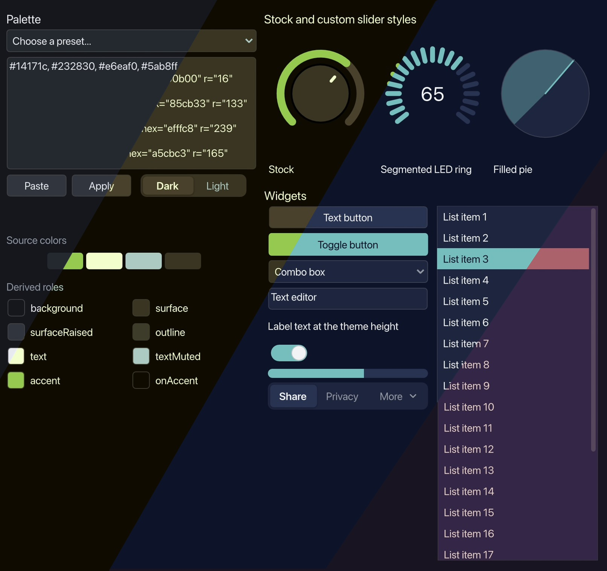

# Component Styling

YUP separates appearance from logic via `ComponentStyle`, colors, and properties.
These cascade: a component inherits values from its parent and from the global
`ApplicationTheme`.

<p align="center">
  
</p>

```cpp
#include <yup_gui/yup_gui.h>
```

---

## Overview

The styling system has three layers:

| Layer | Scope | How to set |
|---|---|---|
| **Per-component** | This component only | `comp.setColor()`, `comp.setProperty()`, `comp.setStyle()` |
| **Type-wide** | All instances of a widget type | `theme->setComponentStyle<T>(style)` |
| **Theme defaults** | Fallback for all components | `theme->setColor()`, `theme->setProperty()` |
| **Palette** | Colors derived from a handful of source colors | `theme->setPalette()` |
| **Stylesheet** | Components matching selectors in a subtree | `comp.setStyleSheet()` |

Color resolution walks: component overrides → parent chain → theme defaults → palette.
A [stylesheet](yui/styles.md) value sits right after the explicit value of each
component on the way, so values set in C++ always win over it.
If nothing is found, the paint function falls back to the palette roles.

---

## Component colors

Colors are identified by `Identifier` strings (e.g. `"background"`,
`"border"`). Each widget class exposes style IDs as `static const` members in a
nested `Style` struct.

### Setting per-component colors

```cpp
comp.setColor ("background", Colors::darkslateblue);
comp.setColor ("border", std::nullopt); // remove override → inherit
```

<p align="center">
  
  
</p>

### Reading colors

```cpp
// Get the override on THIS component only (no parent walk)
std::optional<Color> c = comp.getColor ("background");

// Walk the parent chain only, this never reaches the theme
std::optional<Color> c = comp.findColor ("background");

// Walk the parent chain, then the theme defaults, then the theme palette
std::optional<Color> c = ApplicationTheme::findComponentColor (comp, "background");
```

### Setting theme-level defaults

Theme defaults affect all components that haven't overridden the color locally:

```cpp
auto theme = ApplicationTheme::getGlobalTheme();
theme->setColor (TextButton::Style::backgroundColorId, Colors::cornflowerblue);
```

Theme-level color resolution via `theme->findColor(component, id)`:
1. Calls `component.findColor(id)` (walks parent chain for component overrides).
2. If not found, checks the colors set with `theme->setColor()`.
3. If not found, checks the colors derived from the closest palette set on the component or a parent with `Component::setPalette()`, or else from the theme palette (see [Palettes](#palettes)).

A `PopupMenu` opened relative to a component (`PopupMenu::Options::withRelativePosition()`, as a `ComboBox` opens its list) is also styled by that component's `.yui` stylesheet context and takes the palette and `PopupMenu::Style` values set on that component or its parents unless the menu sets them itself. Submenus track their originating parent `PopupMenu` via a `WeakReference` and inherit its resolved style directly, even when mounted on a higher-level popup container or as desktop windows.

### Widget style IDs

Every themable widget exposes color IDs:

| Widget | IDs (partial list) |
|---|---|
| `TextButton::Style` | `backgroundColorId`, `backgroundPressedColorId`, `textColorId`, `textPressedColorId`, `outlineColorId`, `outlineFocusedColorId` (curated geometry: `cornerRadiusId`, `outlineWidthId`, `focusedOutlineWidthId`) |
| `ToggleButton::Style` | `backgroundColorId`, `backgroundToggledColorId`, `textColorId`, `textToggledColorId`, `borderColorId`, `borderToggledColorId` (curated geometry: `cornerRadiusId`, `outlineWidthId`, `focusedOutlineWidthId`) |
| `SwitchButton::Style` | `switchColorId`, `switchOffBackgroundColorId`, `switchOnBackgroundColorId` (curated geometry: `cornerRadiusId`, `thumbInsetId`, `thumbSizeId`) |
| `Slider::Style` | `backgroundColorId`, `trackColorId`, `thumbColorId`, `thumbOverColorId`, `thumbDownColorId`, `textColorId` (curated geometry: `trackWidthId`, `thumbSizeId`, `rotaryInsetId`) |
| `Label::Style` | `textFillColorId`, `textStrokeColorId`, `backgroundColorId`, `outlineColorId` (curated geometry: `textHeightProportionId`) |
| `TextEditor::Style` | `backgroundColorId`, `textColorId`, `caretColorId`, `selectionColorId`, `outlineColorId`, `focusedOutlineColorId` (curated geometry: `cornerRadiusId`, `outlineWidthId`, `focusedOutlineWidthId`) |
| `ComboBox::Style` | `backgroundColorId`, `textColorId`, `borderColorId`, `arrowColorId`, `focusedBorderColorId` (curated geometry: `cornerRadiusId`, `outlineWidthId`, `focusedOutlineWidthId`) |
| `ScrollBar::Style` | `trackColorId`, `thumbColorId`, `thumbHoverColorId`, `thumbDraggingColorId` (curated geometry: `thumbInsetId`, `cornerRadiusId`) |
| `ProgressBar::Style` | `backgroundColorId`, `foregroundColorId` (curated geometry: `cornerRadiusId`) |
| `ListBox::Style` | `backgroundColorId`, `outlineColorId`, `rowBackgroundColorId`, `selectedRowBackgroundColorId`, `hoveredRowBackgroundColorId`, `refreshIndicatorColorId` (curated geometry: `refreshIndicatorSizeId`) |
| `ListBoxItem::Style` | `textColorId`, `textColorSelectedId`, `backgroundColorId`, `backgroundColorSelectedId`, `backgroundColorHoveredId` |
| `TreeView::Style` | `indentGuideColorId`, `disclosureColorId`, `itemTextColorId`, `itemTextSelectedColorId`, `dropIndicatorColorId`, `itemHoveredColorId` (the rows also use the `ListBox::Style` colors) |
| `TabBar::Style` | `trackColorId`, `indicatorColorId`, `underlineColorId`, `focusOutlineColorId` |
| `TabButton::Style` | `textColorId`, `textSelectedColorId`, `hoveredBackgroundColorId`, `closeButtonColorId` |
| `PopupMenu::Style` | `menuBackground`, `menuBorder`, `menuItemText`, `menuItemTextDisabled`, `menuItemBackground`, `menuItemBackgroundHighlighted`, `menuItemBackgroundActiveSubmenu` (curated geometry: `cornerRadiusId`, `outlineWidthId`, `itemCornerRadiusId`, `itemHeightId`, `verticalPaddingId`) |
| `DocumentWindow::Style` | `backgroundColorId` |
| `MidiKeyboardComponent::Style` | `whiteKeyColorId`, `whiteKeyPressedColorId`, `whiteKeyShadowColorId`, `blackKeyColorId`, `blackKeyPressedColorId`, `blackKeyShadowColorId`, `keyOutlineColorId`, `scrollButtonBackgroundColorId`, `scrollButtonArrowColorId` |
| `KMeterComponent::Style` | `backgroundColorId`, `greenZoneColorId`, `amberZoneColorId`, `redZoneColorId`, `averageLevelColorId`, `peakLevelColorId`, `peakLevelClipColorId`, `peakHoldColorId` |
| `SpectrumAnalyzerComponent::Style` | `backgroundTopColorId`, `backgroundBottomColorId`, `outlineColorId`, `fillColorId`, `gridColorId`, `textColorId` |
| `PitchWheelComponent::Style` | `bodyTopColorId`, `bodyBottomColorId`, `outlineColorId`, `gripColorId`, `gripOverColorId`, `gripDownColorId` |
| `ModWheelComponent::Style` | `bodyTopColorId`, `bodyBottomColorId`, `outlineColorId`, `gripColorId`, `gripOverColorId`, `gripDownColorId` |
| `AudioGraphComponent::Style` | `backgroundColorId`, `gridColorId` |
| `AudioGraphNodeView::Style` | `shadowColorId`, `accentBackgroundColorId`, `bodyBackgroundColorId`, `headerBackgroundColorId`, `textColorId`, `subtitleTextColorId`, `parameterBackgroundColorId`, `parameterValueBackgroundColorId`, `portHoleColorId` |

---

## Component properties

Properties are named values describing a component: themeable colors and curated
geometry (corner radius, spacing) plus reflected state such as a slider's `value`
or a label's `text`. Store-backed properties (colors, geometry) cascade like
colors; state-backed properties read and write the widget's own accessors and
resolve only on the owning component. Values are `var`; use the typed
`getPropertyAs<T>()` / `findPropertyAs<T>()` helpers when you need a concrete type.

### Setting per-component properties

```cpp
comp.setProperty ("corner-radius", 8.0);
comp.removeProperty ("corner-radius"); // remove a store-backed override
```

### Reading properties

```cpp
// Local only (descriptor getter for state-backed, stored value otherwise)
var r = comp.getProperty ("corner-radius");
float rf = comp.getPropertyAs<float> ("corner-radius");

// Cascade: this component, the parent chain, the theme default, then the descriptor default
var r = comp.findProperty ("corner-radius");

// Color properties also fall back to the theme colors and the closest palette
auto thumb = slider.findPropertyAs<yup::Color> ("thumbColor");

bool present = comp.hasProperty ("corner-radius");
```

### Setting theme-level property defaults

```cpp
auto theme = ApplicationTheme::getGlobalTheme();
theme->setProperty ("corner-radius", 4.0);
```

### Curated widget geometry

The default theme paints the corner radii, outline widths, slider tracks and
thumbs and similar values from the curated geometry properties listed in the
[widget style IDs](#widget-style-ids) (names and defaults in
[Stylesheets](yui/styles.md#widget-geometry)). The descriptor default is the
only place each value lives. Like colors they are keyed per widget type, so set
them on the theme, on a container for the widgets inside it, or on one widget:

```cpp
theme->setProperty (TextButton::Style::cornerRadiusId, 8.0); // every text button
panel.setProperty (Slider::Style::thumbSizeId, 12.0);        // the sliders in the panel
button.setProperty ("cornerRadius", 0.0);                    // this button
```

### Binding a reflected property to a model

State-backed properties (`value`, `text`, ...) reflect the widget's own model.
`DataTreeBindingProvider`, `BindingModel` and `BindingGraph` two-way link one of
them to a `DataTree` property, so the widget mirrors the document and writes
edits back:

```cpp
DataTree state ("Filter");
DataTreeBindingProvider provider (state);
BindingModel model (provider);
BindingGraph bindings;

Slider cutoff (Slider::LinearHorizontal);
bindings.link (cutoff, "value", model, "cutoff");
model.trackGestures (cutoff, "cutoff");
```

On link establishment the model seeds the component when the property holds a
value. Dragging the slider updates `state["cutoff"]`; a transaction that changes
`state["cutoff"]` updates the slider. Pass an `UndoManager::Ptr` to
`DataTreeBindingProvider` to make widget edits join the document's undo history:

```cpp
UndoManager::Ptr undo = new UndoManager();
DataTreeBindingProvider provider (state, undo);
```

### Expressions over component properties

`DrawingScope` exposes a component's reflected properties as symbols in a
`yup_expression` program, so an expression can read the live widget by name. A
bare name or `self.` refers to the bound component, `parent.` to its parent:

```cpp
ExpressionContext context;
addGraphicsExpressionTypes (context);        // registers the point, color, ... types
DrawingScope::addExpressionArrayTypes (context); // registers typed array views

Slider slider (Slider::LinearHorizontal);
slider.setValue (0.5);

DrawingScope scope (slider, context);
auto parsed = scope.parse ("out = value * 100");
auto compiled = CompiledExpression::compile (parsed.getReference(), context);

const auto& program = compiled.getReference();
const auto inputs = scope.bindInputs (program);
ExpressionState state (program);
scope.updateInputs (inputs, state); // push the slider's live values
state.evaluate();
// state.getVar (program.findOutput ("out")) is 50 when value is 0.5
```

Number, integer, boolean, string, color, point, rectangle, transform, font and
typed array properties are bridged. Parse through the scope to declare the symbols it reads,
bind the resulting program's input indices once with `bindInputs`, and call
`updateInputs` before each evaluation. The scope holds weak references to the
resolved components, so a destroyed component simply feeds nothing. This is the
foundation data-driven drawing, styling and bindings build on.

### Painting a component from a drawing

A *drawing* paints a component from a tree of independent shapes (`rect`,
`circle`, `arc`, `line`, `text`, ...), each with its own style and with values
written as expressions over the component's properties. `DrawingStyle` installs
a drawing on a component like any other style:

```yui
drawing Knob {
    circle { center: bounds.center; radius: bounds.width / 2 - 2; fill: backgroundColor; }
    arc { center: bounds.center; radius: bounds.width / 2 - 6; from: 135deg;
          to: lerp (135deg, 405deg, normalized); stroke: trackColor; strokeWidth: 3; }
}
```

```cpp
auto style = DrawingStyle::create (slider, drawing); // the parsed `drawing` tree
if (style.wasOk())
    slider.setStyle (style.getReference());
```

See [Data-driven drawing](yui/drawing.md) for the elements, the `let`, `layer`,
`group` and `repeat` scopes, and error reporting.

### Series and parts

Two declarations of a type info let a drawing paint a component of your own
whole: a *series* for the data it shows, a *part* for what a drawing has no
shape for.

```cpp
const ComponentTypeInfo& LevelGraph::getClassTypeInfo()
{
    static const auto info = ComponentTypeBuilder<LevelGraph> (Identifier ("LevelGraph"), Component::getClassTypeInfo())
        .series ("levels", &LevelGraph::getLevels, &LevelGraph::getLevelsRevision, "The level of each band, 0 to 1.")
        .part ("logo", "The logo, painted in the area it is given.")
        .fixedPart ("cursor", &LevelGraph::getCursorBounds, "The cursor, filled with the fill color where the graph puts it.")
        .build();

    return info;
}
```

- **`series`** declares a read-only array property read in place. The getter
  returns a `Span<const T>` over elements the component holds in one block,
  with `T` one of `float`, `int`, `bool`, `String`, `Color`, `Point<float>`,
  `Rectangle<float>`, `AffineTransform` or `Font`. A drawing reading the name
  binds that memory instead of a copy, see
  [Data series](yui/drawing.md#data-series). Change the elements on the message
  thread between two paints, then `repaint()`.
- The optional **revision** getter returns a `uint32` the component changes
  whenever it changes the elements (never 0, which means untracked). A
  [shader sampling the series](yui/shaders.md#series) uploads its texture only
  when the revision moves, instead of comparing the elements.
- **`part`** declares what a drawing places with a `part` element, in the
  area the drawing gives it with `bounds`. Pass an area getter as well to tell
  where the component puts it when the drawing gives none.
- **`fixedPart`** declares a part the component lays out itself, such as the
  text of an editor: a drawing decides when it is painted and with which
  paint, not where.

The type only declares a part: the theme paints it, as it paints the
component, so the drawing code of a component stays in one place.

```cpp
auto theme = ApplicationTheme::getGlobalTheme();

theme->setComponentPart<LevelGraph> ("logo", [] (Graphics& g, const ApplicationTheme&, const LevelGraph& graph, const Rectangle<float>& area)
{
    g.drawImage (graph.getLogo(), area);
});

theme->setComponentPart<LevelGraph> ("cursor", [] (Graphics& g, const ApplicationTheme&, const LevelGraph&, const Rectangle<float>& area)
{
    g.fillRect (area);
});
```

A part painter paints with the paint set on the `Graphics` it gets, so one
function serves the style of the type, which calls it where it wants the part,
and the drawing. A theme that sets no painter for a part paints nothing of it.
A `ComponentStyle` set on one component places a part with
`Component::paintPart`, naming it as the widget does in its `Style`:

```cpp
g.setFillColor (label.findColor (Label::Style::textFillColorId).value_or (Colors::white));
label.paintPart (g, Label::Style::textPartId);
```

[Widgets in drawings](yui/widgets.md) lists the series and the parts of the
built-in widgets.

---

## `ComponentStyle` — per-type paint styles

A `ComponentStyle` is a reference-counted object that paints a specific
component type using a given theme. Each widget type gets its own
`ComponentStyle` registered on the theme.

### Creating a custom paint style

Use the `createStyle<T>(callback)` factory:

```cpp
auto customButtonStyle = ComponentStyle::createStyle<TextButton> (
    [] (Graphics& g, const ApplicationTheme& theme, const TextButton& b)
    {
        auto bgColor = theme.findColor (b, TextButton::Style::backgroundColorId)
                           .value_or (Colors::gray);

        g.setFillColor (bgColor);
        g.fillRoundedRect (b.getLocalBounds(), 6.0f);

        // Draw text, border, etc.
    });
```

The callback receives the `Graphics` context, the current `ApplicationTheme`,
and a typed reference to the component. It is called whenever the component
needs to repaint.

### Attaching a style to a component

```cpp
// Per-instance override
comp.setStyle (customButtonStyle);
ComponentStyle::Ptr s = comp.getStyle();
```

A style set on a component paints what it likes of it: rounded shapes,
translucent colors, or nothing at all in places. So the component is not
painted as an opaque one while it has the style, whatever `isOpaque()` returns:
its parent is painted behind it, and the style needs no background of its own.
The same holds for a [drawing](#painting-a-component-from-a-drawing), which is
a style set on the component.

### Registering a type-wide style on the theme

```cpp
auto theme = ApplicationTheme::getGlobalTheme();
theme->setComponentStyle<TextButton> (customButtonStyle);
```

This makes all `TextButton` instances use the custom style, unless a specific
instance has called `comp.setStyle()` with its own override.

A type-wide style leaves the opaque state of the components as it is: for a
type that is opaque, it has to paint every pixel of the bounds with an opaque
color.

### Removing a style

```cpp
comp.setStyle (nullptr); // revert to type-wide or default
```

### `styleChanged()` callback

When a component's style changes (via `setStyle`, or when a color or property
override is set), the virtual `styleChanged()` method is called. Override it to
repaint:

```cpp
void MyButton::styleChanged() override
{
    repaint();
}
```

---

## `ApplicationTheme`

The global theme singleton holds fonts, default colors and properties, and
type→style mappings.

### Creating and setting the global theme

```cpp
auto theme = createThemeVersion1(); // built-in theme (Roboto + FontAwesome7)
ApplicationTheme::setGlobalTheme (std::move (theme));
```

### Accessing the global theme

```cpp
auto theme = ApplicationTheme::getGlobalTheme();
```

### Theme fonts

```cpp
theme->setDefaultFont (myFont);
theme->setDefaultIconFont (myIconFont); // FontAwesome7

const Font& font     = theme->getDefaultFont();
const Font& iconFont = theme->getDefaultIconFont();
```

The built-in theme uses a 14 px default font. Buttons, combo boxes, labels, text
editors, list rows and menus all draw their text at that height (smaller only
when the widget is too short to fit it).

### Batch color/property registration

```cpp
theme->setColors ({
    { TextButton::Style::backgroundColorId, Colors::cornflowerblue },
    { Slider::Style::thumbColorId, Colors::orange },
});

theme->setProperties ({
    { "corner-radius", 8.0 },
    { "padding", 4.0 },
});
```

### Finding values through the theme

Theme `findColor` checks the component's parent chain first, then falls back to
theme defaults. Theme `findProperty` only holds the theme-wide property defaults;
the component/parent cascade lives on `Component::findProperty`:

```cpp
// findColor first calls component.findColor, then checks theme defaults
auto c = theme->findColor (comp, "background");

// findProperty returns the theme default for the id (component cascade is comp.findProperty)
auto m = theme->findProperty (comp, "corner-radius");

// Static convenience wrappers on the global theme:
auto c = ApplicationTheme::findComponentColor (comp, "background");
auto m = ApplicationTheme::findComponentProperty (comp, "corner-radius");
```

---

## Palettes

A `ThemePalette` turns a few source colors, for example the export of an online
palette generator, into the semantic roles a theme needs:

| Role | Used for |
|---|---|
| `background` | Window and page background |
| `surface` | Fields, lists and other inset areas |
| `surfaceRaised` | Buttons, menus and other raised areas |
| `outline` | Borders and separators |
| `text` / `textMuted` | Primary and secondary text |
| `accent` / `onAccent` | Selection, focus and active values, and text drawn on them |

The roles are derived deterministically (the order of the source colors does not
matter), text is always readable against the background, and missing colors are
derived, so a single source color still gives a complete palette. Palettes are
dark by default, pass `ThemePalette::Mode::light` for a light one.

<p align="center">
  
  
</p>

```cpp
// From colors
ThemePalette palette (std::vector<Color> { Color (0xff100b00), Color (0xff85cb33), Color (0xffefffc8) });

// From text: XML with <color hex="..."> or <color r g b> elements, CSS, hex lists or palette URLs
auto result = ThemePalette::fromString ("https://coolors.co/100b00-85cb33-efffc8-a5cbc3-3b341f",
                                        ThemePalette::Mode::dark);
if (result.failed())
    YUP_DBG (result.getErrorMessage());

// Tweak a single role
palette.setColor (ThemePalette::Role::accent, Colors::orange);
```

Switch the palette of the whole application at runtime, then repaint:

```cpp
ApplicationTheme::getGlobalTheme()->setPalette (result.getReference());
topLevelComponent->repaint();
```

Repainting the top-level component is enough: what the components below keep
of their painting, such as a [texture cache](component-caching.md), is painted
again with the new theme.

A theme turns the palette roles into widget colors with a palette mapping
(`theme->setPaletteMapping()`, which calls `theme->setPaletteColor()`); the
built-in theme maps every widget color it paints. You can also pass a palette
when creating it: `createThemeVersion1 (palette)`.

Colors set with `theme->setColor()` always win over the palette and survive
palette changes, and colors set on a component win over both. Custom paint
styles should read `theme.getPalette (component).getColor (role)` at paint time
so they follow palette switches and component palettes too.

### Component palettes

The theme palette is global. To give part of the interface a palette of its own,
set it on a component: the component and everything inside it are drawn from the
closest palette up the parent chain, mapped to widget colors by the theme's
palette mapping.

```cpp
// A window, a panel or a plugin editor wears its own palette
editor.setPalette (ThemePalette::fromString ("https://coolors.co/0b132b-1c2541-3a506b-5bc0be-6fffe9").getReference());

// Follow the parent again
editor.setPalette (std::nullopt);
```

<p align="center">
  
  
</p>

This is how several plugin editors in one process, which share the global theme,
can each wear their own palette. `ApplicationTheme::getPalette (component)` returns
the palette a component is drawn with, and `Component::findPalette()` the closest
one set on it or a parent.

---

## Icons

The built-in theme (`createThemeVersion1()`) registers FontAwesome 7 as the icon
font. Icons are rendered as text using the icon font. ~600+ icon glyphs are
available as `YUP_ICON_*` macros:

```cpp
#include <yup_gui/themes/theme_v1/yup_ThemeVersion1_Icons.h>

// The macros are UTF-8 literals, which a String only takes through fromUTF8
String iconText  = String::fromUTF8 (YUP_ICON_GEAR);         // ⚙
String checkmark = String::fromUTF8 (YUP_ICON_CIRCLE_CHECK); // ✅
```

<p align="center">
  
  
</p>

To draw an icon, obtain the theme's icon font and draw the glyph as text:

```cpp
void MyButton::paint (Graphics& g) override
{
    auto theme = ApplicationTheme::getGlobalTheme();
    const auto iconFont = theme->getDefaultIconFont().withHeight (16.0f);

    g.setFillColor (findColor (TextButton::Style::textColorId)
                        .value_or (Colors::white));
    g.fillFittedText (String::fromUTF8 (YUP_ICON_GEAR), iconFont, getLocalBounds(), Justification::center);
}
```

---

## Full example — custom styled button

```cpp
class StyledPanel : public Component
{
public:
    StyledPanel()
    {
        addAndMakeVisible (button);
        button.setTitle ("Save");
    }

    void resized() override
    {
        button.setBounds (getLocalBounds().reduced (20));
    }

    static inline auto kCustomStyle = ComponentStyle::createStyle<TextButton> (
        [] (Graphics& g, const ApplicationTheme& theme, const TextButton& b)
        {
            auto bgColor = b.findColor (TextButton::Style::backgroundColorId)
                               .value_or (Colors::darkslateblue);

            g.setFillColor (bgColor);
            g.fillRoundedRect (b.getLocalBounds(), 12.0f);

            g.setFillColor (Colors::white);
            g.fillFittedText (b.getTitle(), theme.getDefaultFont().withHeight (14.0f), b.getLocalBounds(), Justification::center);
        });

private:
    TextButton button;

    YUP_DECLARE_NON_COPYABLE_WITH_LEAK_DETECTOR (StyledPanel)
};

// Register the custom style (e.g., in main or plugin setup):
auto theme = createThemeVersion1();
theme->setComponentStyle<TextButton> (StyledPanel::kCustomStyle);
ApplicationTheme::setGlobalTheme (std::move (theme));
```

---

## Related

- [How YUI fits together](yui/architecture.md) - how properties, stylesheets,
  drawings and bindings relate
- [Stylesheets](yui/styles.md) - CSS-like rules setting properties on any
  component tree
- [Component basics](component-basics.md) — `setColor`, `setProperty`, `setStyle` APIs
- [Component effects (shaders)](component-effects.md)
