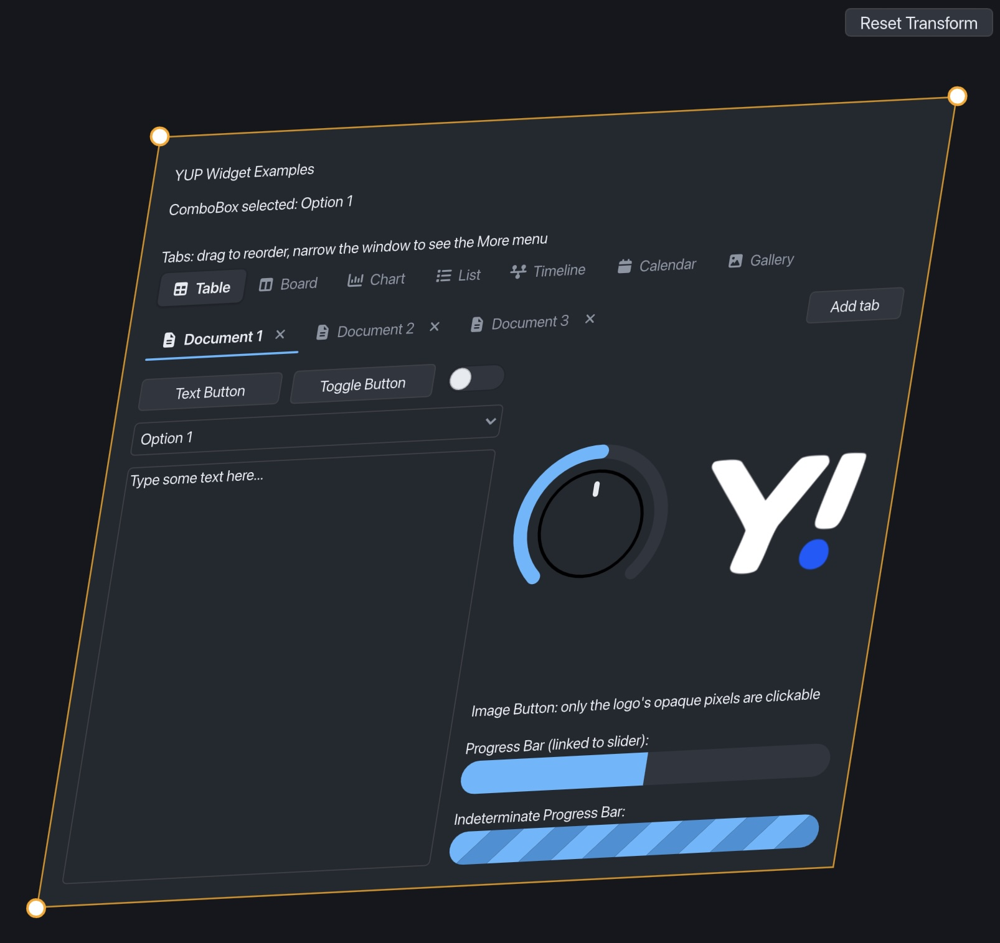

# UI

The GUI layer: components, windowing, event handling, layout, and widgets that
paint through the [graphics](../graphics/index.md) stack.

<p align="center">
  
</p>

**Modules covered:** `yup_gui`, `yup_events`, `yup_audio_gui`.

```{warning}
**Work in progress.** This area is still being written. Concept guides for
windowing and theming are still to come.
```

## How it fits together

A `Component` is a rectangle in a tree. It paints itself with
[`Graphics`](../graphics/graphics-class.md), receives mouse, touch, keyboard and
gesture input, and lays out its children. The root of a tree is hosted by a
`ComponentNative` - a native window on desktop and mobile, a canvas on the web -
which owns the `GraphicsContext` the whole tree paints into. `yup_events` drives
it all: the message loop, timers and dispatch.

Everything you can do from C++ you can also declare in a
[`.yui` document](yui/index.md), which builds the same component tree from text
and reloads while the application runs.

## Components

The core model: the tree, painting, input, layout and styling.

- [Component basics](component-basics.md) - the `Component` tree, painting,
  input, visibility and lifecycle.
- [Component layout](component-layout.md) - `FlexBox` and `Grid`, the
  flexible and track-based layout containers modelled on CSS.
- [Component styling](component-styling.md) - colors, properties,
  `ComponentStyle` and `ApplicationTheme`, with theme cascading.
- [Gestures](gestures.md) - touch and trackpad gestures: tap, long press,
  pinch, rotate, multi-finger pan and swipe, with `setWantedGestures`.
- [Drag and drop](component-drag-and-drop.md) - drop targets, drag sources,
  payloads and the drag session, in one window or across several.

## YUI, the declarative UI language

[YUI](yui/index.md) describes a whole interface - layout, stylesheet, drawings
and bindings - in `.yui` text that is loaded at startup and hot reloaded while
you edit it.

- [The `.yui` language](yui/language.md) - blocks, elements, values,
  declarations and imports.
- [How YUI fits together](yui/architecture.md) - the classes behind documents,
  styling, drawings and bindings.
- [Declarative layout](yui/layout.md) - `Row`, `Column`, `FlexBox`, `Grid` and
  `Stack` in `.yui`.
- [Stylesheets](yui/styles.md) - selectors, the cascade, palettes, transitions,
  shadows, glows, filters and cursors.
- [Data-driven drawing](yui/drawing.md) - shapes whose values are expressions
  over the component's properties.
- [Reactive bindings](yui/reactivity.md) - properties recomputed whenever what
  they read changes.
- [Complete UIs in `.yui`](yui/documents.md) - `YuiDocument`, tokens, composite
  components, handlers, actions and models.
- [Hot reloading `.yui` files](yui/hot-reload.md) - `YuiLoader` and embedded
  resources.
- [Tools for `.yui` files](yui/tooling.md) - the checker, the schema, the SVG
  importer and the VS Code extension.

## Rendering and performance

What happens between `paint()` and the screen, and how to make it cheaper.

- [Component effects (shaders)](component-effects.md) - GPU shader effects
  applied to a `Component` subtree.
- [Component caching](component-caching.md) - `setCachedToTexture`, caching a
  subtree's paint output in a GPU texture.
- [Component snapshots](component-snapshots.md) - `snapshotToImage` and
  `snapshotToTexture` for pixel capture.
- [Components in 3D](component-3d.md) - live, interactive components on 3D
  geometry with `setManuallyComposited` and `MeshSurfaceMapper`.
- [Component paint profiling](component-profiling.md) - measure and reduce the
  cost of `Component::paint`.

## Widgets

The components that ship with the framework, beyond the buttons, sliders,
labels and text editors covered by [component basics](component-basics.md).

- [List box](list-box.md) - `ListBox` and `ListBoxModel`, custom rows, change
  notifications, touch scrolling and pull-to-refresh.
- [Tree view](tree-view.md) - `TreeView` and `TreeViewItem`, lazy loading,
  custom content, drag and drop reordering, `DataTree` mirroring and saved
  openness state.
- [Tabs](tabs.md) - `TabBar`, `TabButton` and `TabComponent`: segmented
  controls and tabbed pages with animated selection, reordering, overflow and
  closable tabs.
- [Resizable divider](resizable-divider.md) - `ResizableDivider`, a draggable
  bar splitting two panes, with limits, resize policies, snapping, collapsing
  and keyboard control.
- [Joystick](joystick.md) - `JoystickComponent`, an XY pad moving a thumb over
  two ranged axes, with overlapping thumb-only joysticks for graph nodes.
- [Code editor](code-editor.md) - `CodeDocument`, `SyntaxDefinition`,
  `CodeTokeniser` and the syntax-highlighting `CodeEditor`.
- [MIDI keyboard](midi-keyboard.md) - `MidiKeyboardComponent`, multitouch
  playing, scroll buttons and the available / visible key ranges.
- [Artboards (Rive)](artboard.md) - `ArtboardFile`, `Artboard`, `ArtboardNode`
  and ViewModel data binding.

## Platform integration

- [File chooser](file-chooser.md) - `FileChooser` for opening and saving files,
  and how picks behave on the web.
- [Toast notifications](toast-notifications.md) - the cross-platform
  `ToastNotification` utility and its `ToastTemplate`, delivered by the
  platform notification backend.

## Related areas

- [Graphics](../graphics/index.md) - the `Graphics` API every component paints
  with, and the contexts that host a window.
- [Imaging](../imaging/index.md) - the `Image` type snapshots produce.
- [Animation](../animation/index.md) - Lottie animations played inside a component.
- [3D](../3d/index.md) - `SceneComponent`, a component drawing a 3D scene.
- [Multithreading](../core/multithreading/index.md) - the message manager the UI
  thread runs on.

```{toctree}
:hidden:
:maxdepth: 2

component-basics
component-layout
component-styling
gestures
component-drag-and-drop
yui/index
component-effects
component-caching
component-snapshots
component-3d
component-profiling
list-box
tree-view
tabs
resizable-divider
joystick
code-editor
midi-keyboard
artboard
file-chooser
toast-notifications
```
