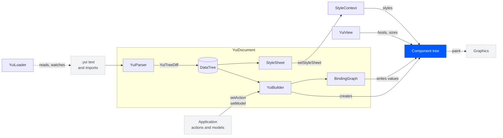
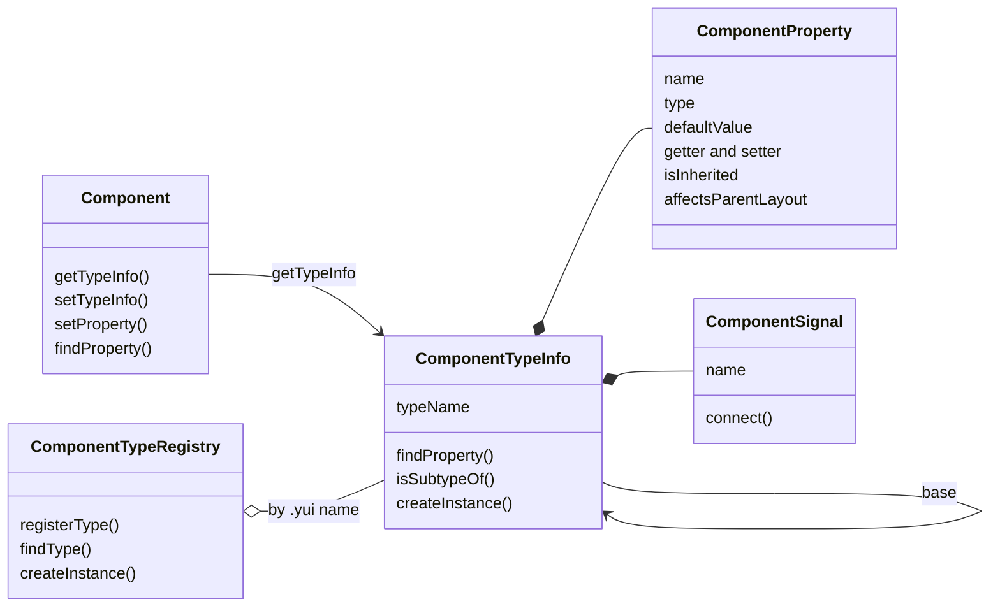
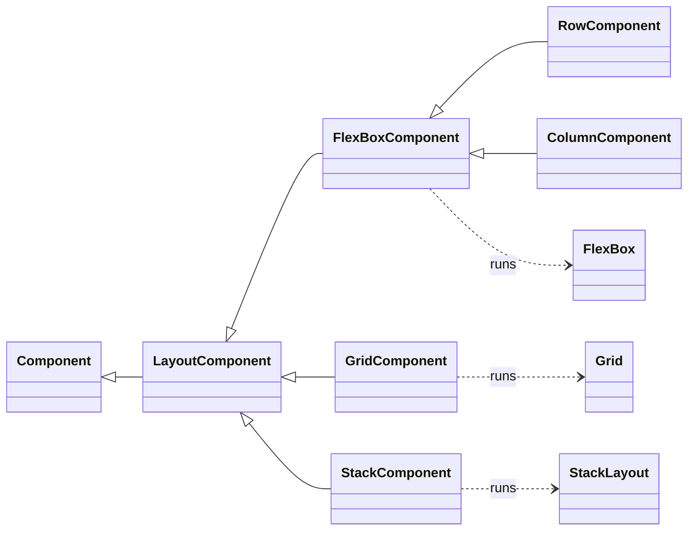
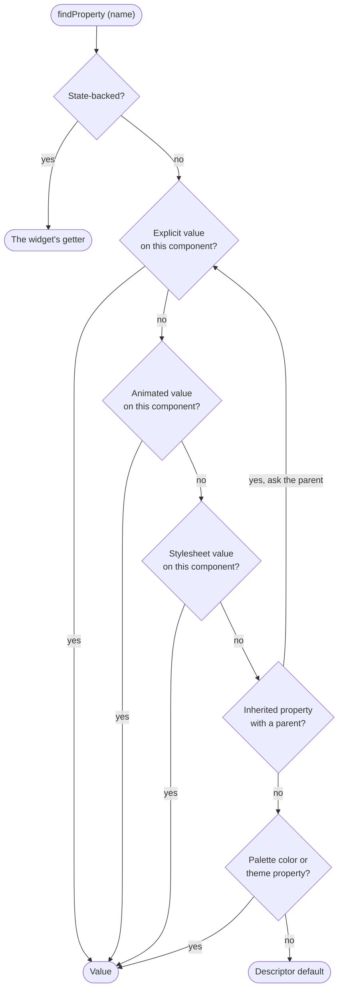
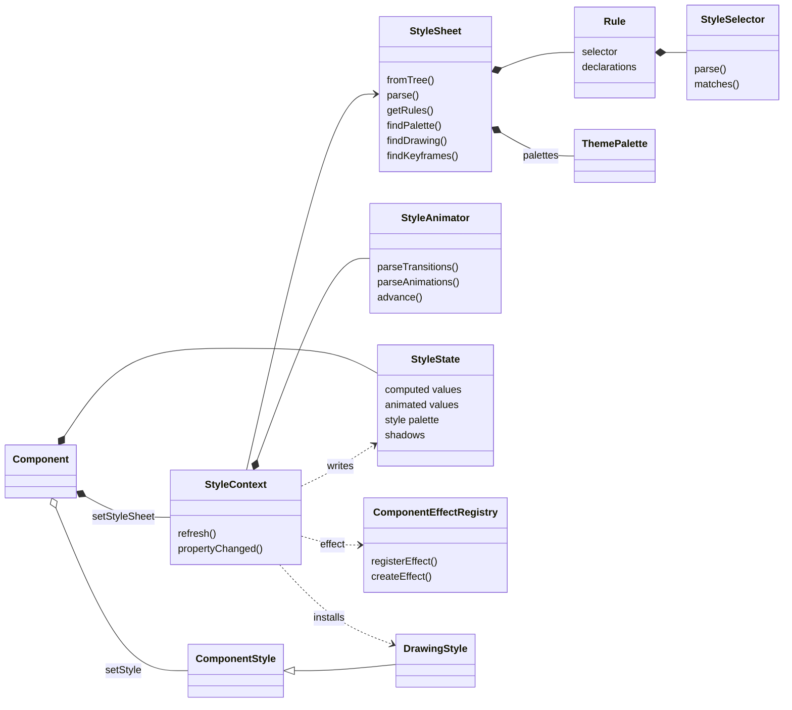
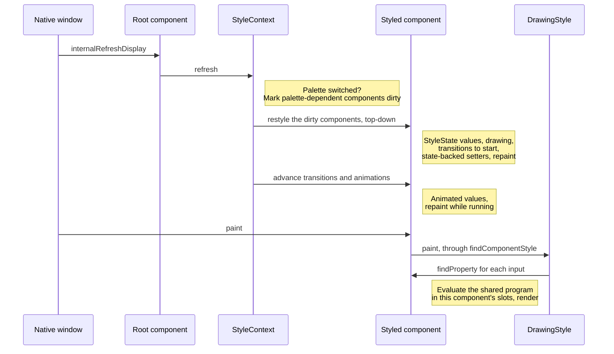
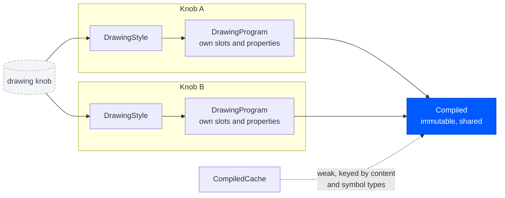
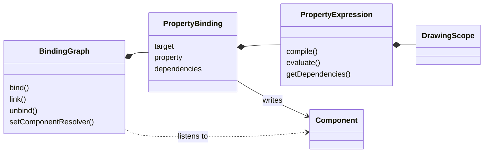
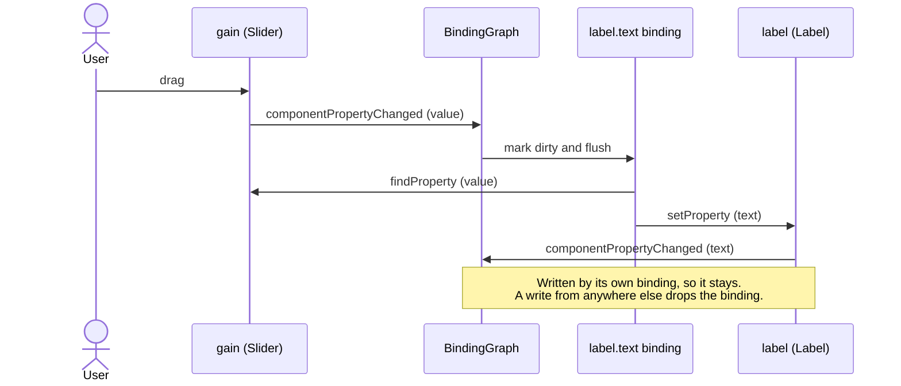
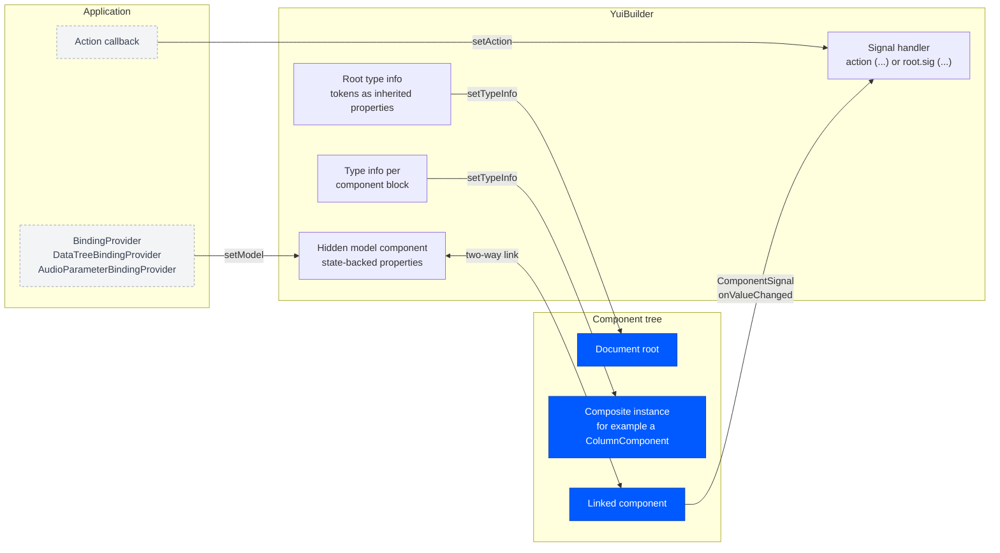

# How YUI fits together

YUI builds a user interface from `.yui` text: components and their properties,
stylesheets that dress them, drawings that paint them and bindings that keep
their values up to date. This page maps the classes involved and how data flows
between them, one layer at a time. The other guides explain how to use each
layer.

## The big picture

- `YuiParser` turns the text, and the files it imports, into one `DataTree`.
  On a reload, `YuiTreeDiff` patches the live tree with it, so the builder keeps
  the components of the elements still there.
- `StyleSheet` collects the `style`, `palette` and `drawing` blocks of that tree.
- `YuiBuilder` creates the components, applies their properties and routes every
  expression through a `BindingGraph`.
- `Component::setStyleSheet` attaches the sheet to the root, which creates the
  `StyleContext` that styles the whole subtree.
- `YuiDocument` runs these steps in order and owns the results.
- `YuiLoader` feeds a document the text of files or embedded resources, with
  in-memory overrides for unsaved edits, and reloads it when the files change.
  `YuiView` owns a document and its loader, and hosts the root as a child
  filling its bounds.

Only the parser, the builder and the document are specific to `.yui`. A
hand-written C++ tree can take a stylesheet, drawings and a `BindingGraph` too.

## Properties, the shared language

Every layer talks to components through named, typed properties. A component's
`ComponentTypeInfo` describes them with `ComponentProperty` descriptors, together
with its `ComponentSignal`s and a factory.

- Type infos chain to their base, so a `Row` has every property of `FlexBox`,
  `Layout` and `Component`. Type selectors and the builder walk the same chain.
- `ComponentTypeRegistry` maps the `.yui` type names to type infos and creates
  instances from them.
- A component returns its class type info, unless `setTypeInfo` gave it one of
  its own. Composite components and the document root (for tokens) use this to
  add properties at runtime.
- A descriptor with a getter is *state-backed*: the value lives in the widget
  (a `Slider` value, a `Label` text). Every other property is *store-backed*: the
  value lives in the component's property store.

### Layout containers

Layout containers are components too. Their own properties (`gap`, `padding`,
`direction`, `columns`) and their children's item properties (`flexGrow`,
`margin`, `gridArea`) feed a layout algorithm.

Item properties are not inherited and are flagged `affectsParentLayout`. When
one changes on a child, its container gets `childLayoutChanged` and lays out
again.

## Where a property value comes from

`Component::findProperty` is the single read path. Painting, drawings, bindings
and layouts all read through it.

Each layer has one writer:

| Layer | Written by |
| --- | --- |
| Explicit | `setProperty` from C++, `.yui` values and bindings |
| Animated | `StyleContext`, from the transitions and animations its `StyleAnimator` runs |
| Stylesheet | `StyleContext`, into the component's `StyleState` |
| Theme | `ApplicationTheme` and the palette in effect for the component |
| State-backed | The widget itself. A stylesheet sets it through the setter, animated values included, and restores the original value when the rule stops matching. |

## Styling

- A `StyleSheet` is immutable and shared. It holds rules (a `StyleSelector` and
  its declarations), `@keyframes`, palettes and drawings.
- The component the sheet is attached to owns the `StyleContext`. The context
  marks components dirty when their classes, interaction state, children or a
  property a selector watches change.
- Restyling a component writes its `StyleState`: the computed values and the
  palette chosen with `palette:`. A `drawing:` declaration installs a
  `DrawingStyle` with `setStyle`.
- Declaration values that are expressions are compiled with
  `PropertyExpression`, like bindings.
- `transition:` and `animation:` declarations are run by the context's
  `StyleAnimator`. While something runs, every frame writes the values to show
  into the animated layer of the `StyleState`.
- `shadow:` layers are kept in the `StyleState` and painted by the component
  before its content. `effect:` creates a `ComponentEffect` through the
  `ComponentEffectRegistry`, `cursor:` sets the mouse cursor.

### One frame

Styling is batched once per frame, before painting.

## Drawings

A `DrawingStyle` is a `ComponentStyle` that runs a `DrawingProgram`. Components
painted by the same drawing share one immutable compilation and keep their own
evaluation state, so ten knobs compile the drawing once.

A `DrawingScope` resolves the names an expression reads. Drawings and property
expressions share the same rules:

| Name | Read from |
| --- | --- |
| `palette.primary` | The palette in effect for the component |
| `self.value`, `parent.width` | The component or its parent |
| `gain.value` | The element with id `gain`, found by the builder |
| `value` | The component's own property, else the closest ancestor declaring it as inherited (a token) |
| `bezelSize` | A `property` declared by the drawing, read with `findProperty` at each paint |

## Bindings

Each `PropertyBinding` keeps one property up to date from an expression and
remembers the properties it read. The graph listens to every component involved
and re-evaluates only the bindings that read what changed:

The same change notification reaches the `StyleContext`, which restyles when a
selector watches that property. A two-way link made with `link` copies changes
in both directions and survives writes.

## Documents

The builder turns the declarations of a document into the pieces above.

- A `component Name : Base` block becomes a type info derived from the base. An
  instance is a plain component of the base class carrying that type info, so
  selectors, drawings and bindings see its extra properties like built-in ones.
- Tokens become inherited properties of the document root, so any expression
  below it can read them by name.
- A model wraps a `BindingProvider` in a hidden component whose state-backed
  properties forward to the provider. `model.cutoff` then reads like any other
  property, and `<=>` reuses the graph's links. Drags on linked components open
  and close the provider's gestures, and any other change is a gesture of its own.
- A property named after a signal connects a handler. When the signal fires, the
  handler runs a document action or emits a signal declared by a composite.

## See also

- [Complete UIs in `.yui`](yui-documents.md) - the document API, tokens,
  composites, handlers and models.
- [Reactive bindings](yui-reactivity.md) - bindings and links in practice.
- [The `.yui` language](yui-language.md) - the syntax of every block.
- [Stylesheets](yui-styles.md) - selectors, the cascade and palettes in practice.
- [Data-driven drawing](yui-drawing.md) - the drawing language and its scopes.
- [Component styling](component-styling.md) - the property model, palettes and
  `ComponentStyle`.
- [Component Layout](component-layout.md) - the layout algorithms behind the
  containers.
